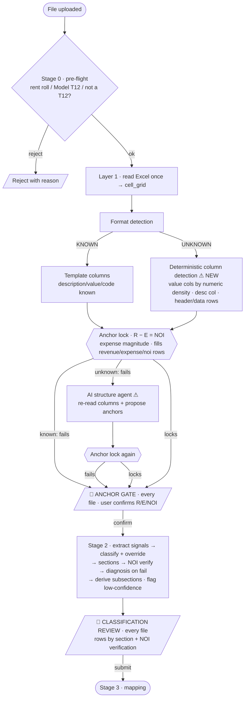

# New Workflow + Data Dry-Run (file upload → NOI verification)

Companion to [`../proposals/t12_parsing_proposal.md`](../proposals/t12_parsing_proposal.md)
(the current as-built concept). This doc tracks:

1. the **target workflow** — with the **deterministic-first** structure detection for unknown
   files (planned; see [`PLANNED_ENHANCEMENTS.md`](./PLANNED_ENHANCEMENTS.md) §2), and
2. a **dry run of the run-state** — the actual JSON produced at each step, so you can see what
   data exists when.

The **data shapes below are real** (captured from `Pointe Inverness T12 11-25.xlsx`, a known
`code_in_a_desc_in_b` file). The only workflow difference between "current" and "target" is the
unknown-branch routing (marked ⚠ below); every data shape is identical.

---

## Workflow (target)



`⚠` = the only change vs the current workflow. **Known branch is unchanged.** For unknown files
the AI is now a **fallback** (only if the deterministic lock can't reconcile) instead of the
default. Everything after "columns known" is the same code for both branches.

---

## Dry run — the run-state at each step

There is **one `state.json` per upload**, enriched as it goes (`cell_grid` is a heavy side
artifact, stored separately). Below, each step shows the slice(s) it *adds*.

### 1 · Pre-flight  → `state.preflight`

```json
{ "ok": true, "kind": "t12", "reason": "T12 income statement." }
```

`kind` ∈ {t12, rent_roll, model, not_t12}. If `ok:false`, the upload is rejected here.

### 2 · Layer 1 (read Excel once)  → `cell_grid.json` (side artifact)

```
rows=155  (non-empty)   max_row=172   max_col=48
```

Every later step reads this; the workbook is never reopened.

### 3 · Format detection  → `state.format`

```json
{ "format": "code_in_a_desc_in_b", "confidence": 0.698 }
```

`code_in_a_desc_in_b` / `embedded_code_in_a` / `no_code` → **known**; anything else → **unknown**.

### 4 · Resolve columns  → `state.structure_map`  (columns only; anchors + subsections EMPTY)

```json
{ "description_columns": ["B"], "code_column": "A", "code_embedded_in_description": false,
  "value_columns": ["C","D","E","F","G","H","I","J","K","L","M","N","O"],
  "month_header_row": 7, "data_start_row": 10,
  "revenue_end_row": null, "expense_end_row": null, "noi_row": null,
  "validated_subsection_subtotal_rows": [] }
```

- **Known** (shown): columns come from the format template (`build_known_map`).
- **Unknown ✅ (built — [`PLANNED_ENHANCEMENTS.md`](./PLANNED_ENHANCEMENTS.md) §2):**
  `detect_structure_deterministic` reads this *same shape* off the grid (value cols = longest
  numeric run; description = columns left of it minus bare code columns). The **anchor lock is the
  oracle**: if it reconciles, the columns were right and we skip the AI; only a NONE lock falls
  back to the AI agent (which re-produces columns + *proposed* anchors + rich `subsections`, all
  still re-decided by the arithmetic). `state.structure_source` records which path ran. Verified:
  all 7 validated unknown files reconcile deterministically — no AI.

### 5 · Anchor lock (Stage 1)  → `state.anchor_lock`  +  anchors filled into `structure_map`

```json
// state.anchor_lock
{ "status": "AUTO", "method": "auto",
  "candidates": { "revenue": [47], "expense": [170], "noi": [172] },
  "passing":    [ [47, [170], 172] ],
  "anchors":    { "revenue_end_row": 47, "expense_end_row": 170, "noi_row": 172,
                  "expense_split_rows": null } }
// structure_map now: revenue_end_row=47, expense_end_row=170, noi_row=172   (subsections still [])
```

**Arithmetic-first** (done — [`PLANNED_ENHANCEMENTS.md`](./PLANNED_ENHANCEMENTS.md) §1): the
`R − |E| = NOI` math finds every reconciling triple over *all* value-bearing rows (hash-join on
the annual total, `O(n²)`); keywords only **rank** the survivors, they no longer gate which rows
are candidates. So a novel vendor term still locks.

- `status` = **AUTO** (one clear triple, NOI keyword-confirmed) · **DERIVED** (one clear triple,
  but the NOI row carried no NOI keyword — found purely by the math) · **GATE** (several
  contenders tie on keyword-confirmation + revenue magnitude) · **NONE** (nothing reconciled).
- `passing` = the **contenders** only (winner + genuine either/or alternatives, e.g. Carmel's
  single `[157]` vs split `[136,156]`). Coincidental sub-arithmetic triples rank below and are
  dropped so the gate isn't spammed.
- `candidates` = the keyword shortlist (now just the ranker / the gate's pre-populated selects).
- `state.anchor_rows` holds the light `{row, description, values}` list the gate renders.

### 6 · 🛑 Anchor gate → user confirms → `state.anchors`

```json
{ "revenue_end_row": 47, "expense_end_row": 170, "noi_row": 172 }
```

`anchor_lock.status` flips to `MANUAL`. Every file stops here (AUTO just pre-fills it).

### 7 · Classify (Stage 2, on confirm)  → `state.classification`  +  subsections filled

```json
// structure_map gains: "validated_subsection_subtotal_rows": [12,45,64,69,107,112,129,146,157,162,168]
// state.classification:
{ "classified": [
     { "row": 7,  "description": "Account Name",         "class": "METADATA", "section": "metadata", "confidence": 0.25, "low_confidence": false },
     { "row": 10, "description": "Gross Potential Rent", "class": "DATA",     "section": "revenue",  "confidence": 0.20, "low_confidence": false },
     { "row": 47, "description": "Effective Gross Income","class": "SECTION_SUBTOTAL", "section": "revenue", ... },
     ...
  ],
  "noi": { "months": [ ..., { "col": "O", "rev": [3402169, 3402169, true],
                              "exp": [1279404, 1279404, true],
                              "noi": [2122765, 2122765, true] } ],
           "overall_pass": true },
  "low_confidence_rows": [],
  "column_headers": ["Dec 2024", ..., "Total"],
  "diagnosis": null }
```

class distribution: `METADATA=1 · DATA=120 · SUBSECTION_SUBTOTAL=11 · SECTION_SUBTOTAL=4 · COMPUTED_METRIC=1`.
NOI totals: revenue `3,402,169 / 3,402,169` · expense `1,279,404 / 1,279,404` · NOI `2,122,765 / 2,122,765` → **PASS**.
(If NOI had failed, the AI **diagnosis** loop would fill `diagnosis`.)

### 8 · 🛑 Classification review

The page reads `state.classification` directly: NOI verification on top, then every row bucketed
by section (revenue / expense / capex) with its class + confidence, low-confidence rows flagged.
On **Save & Continue** → Stage 3 mapping (`state.mapping`).

---

## Where each field gets filled (quick reference)

| field                                  | filled by                                  | stage |
| -------------------------------------- | ------------------------------------------ | ----- |
| `preflight`                          | pre-flight screen                          | 0     |
| `format`                             | format detection                           | 1     |
| `structure_map` columns              | known template / deterministic detect / AI | 1     |
| `revenue/expense/noi_row`            | **anchor lock** (arithmetic)         | 1     |
| `anchors` (confirmed)                | **user at the gate**                 | 1→2  |
| `validated_subsection_subtotal_rows` | **arithmetic scan in classify**      | 2     |
| `classification` (rows + noi)        | classify + NOI verify                      | 2     |
| `mapping`                            | rulebook + AI fallback                     | 3     |

---

## Module roles (so the layout below makes sense)

- **Every module** exposes `run(state) -> state` (reads its slices, adds its own) **and** the
  underlying **pure function** (takes exactly its inputs — great for unit tests). The pipeline
  uses `run(state)`; tests/scripts can call the pure function.
- **We pass the *whole* state to each step on purpose** — if a step later needs one more slice,
  we change *only that step*, not the view/router.
- **`stages.py`** = the **`STEPS` registry** (name → step) that `run_step` dispatches on, plus the
  **composite groupings** (`stage1`, `classify`) so a view calls `run_step("stage1")` instead of
  six micro-calls. It is **not** a full-pipeline runner. NOI failure is handled *inside* `classify`
  (the AI diagnosis loop), so there is no gap when a stage runs step-by-step.
- **`run_parse.py`** (`parse_file`) = the one-pass **CLI / test runner** (stage1 + classify in
  memory, flattened). The app never calls it.
- **`legacy_adapter.py`** (`to_annotated` + `column_headers`) = the **mapping-input adapter** —
  builds the old `annotated_blocks` shape the mapping stage still consumes, in-memory. Retires
  when the mapping stage reads classified rows directly.

---

## Planned work / cleanup (to do)

### W1 · Config-driven known-format templates

Today the known-format columns are **hardcoded constants** in `parsing/signals.py` (`CODE_COL`,
`DESC_COL`, `EMB_DESC_COL`, `NOCODE_DESC_COL`), used only in `structure_map.build_known_map`.
Move them to **`config/known_formats.json`** (+ `config/paths.py` path), so `build_known_map`
loads them and a new format is just a new entry — same pattern as `anchor_keywords.json`:

```json
{ "code_in_a_desc_in_b": { "description_columns":["B"], "code_column":"A",
    "code_embedded_in_description":false, "code_pattern":null, "value_start_column":"C" },
  "embedded_code_in_a":  { "description_columns":["A"], "code_column":null,
    "code_embedded_in_description":true,  "code_pattern":"embedded", "value_start_column":"B" },
  "no_code":             { "description_columns":["A"], "code_column":null,
    "code_embedded_in_description":false, "code_pattern":null, "value_start_column":"B" } }
```

### W2 · Remove the dead old-batch code

The new flow (UI) uses only `parsing/` + `mapping/{map_blocks,find_mapping}` + `config/` +
`build_rulebook/`. The old batch pipeline is **unused** (verified: `parsing/` and `mapping/`
import nothing from it, and `build_rulebook` only *mentions* the manifest in a comment). Delete:
`detection/` (whole), `manifest/` (whole), `run_pipeline.py`, `mapping/run_stage.py`,
`runner_utils.py`, and `utils/` (excel exporters, imported by nothing). Then update
`t12_pipeline/CLAUDE.md` (it still documents the `run_pipeline` batch flow).

### W3 · Reorganize `parsing/` into stage folders

```
parsing/
├── stage1_structure/   cell_grid · signals · format_detect · preflight ·
│                        structure_map · structure_agent · extract · anchor_lock
├── stage2_classify/    classify · sections · noi · feedback
├── stages.py  ·  run_parse.py  ·  legacy_adapter.py
mapping/  → stage3_mapping/   (map_blocks · find_mapping)
```

Mechanical (import refactor only — no data-path changes).

### W4 · Centralize the wiring so a reorg touches one place

- **Data paths** already centralize in `config/paths.py` (keep using it; add `KNOWN_FORMATS_PATH`).
- **Module wiring:** the bridge already calls steps by *name* via `stages.STEPS` (so it's decoupled
  from module locations). Close the last gap by **re-exporting the bridge's few direct helpers
  through the `parsing` package `__init__.py`** (`extract_cell_grid`, `screen_name`,
  `screen_structure`, `to_annotated`) — then W3's reorg updates only `__init__.py` + `stages.py`,
  never the bridge or views. (Python `import` can't be driven from `paths.py`; this is the clean
  equivalent.)

### W5 · Retire `legacy_adapter` (one vocabulary end-to-end) — optional

`legacy_adapter.to_annotated` only exists because the mapping stage still reads the OLD row
vocabulary (`type` / `statement_side` / `section_path`). Not required — it's transitional. To
remove it: (1) **add `section_path` / `section_context` onto the classified rows** in Stage 2 (a
small step that walks the rows and accumulates the SECTION/SUBSECTION-header stack — the logic
`to_annotated` does today), and (2) **update `map_blocks`** to read the new vocabulary
(`class=="DATA"`, `section`, row-level `section_path`). Then the mapping stage reads
`state.classification.rows` directly and `to_annotated` is deleted. Low priority / low harm (the
adapter is 2 small functions and lives in the pipeline, not the bridge); risk sits in the
AI-heavy mapping stage. **Best done alongside W3** (when we touch `mapping/` → `stage3_mapping/`).
