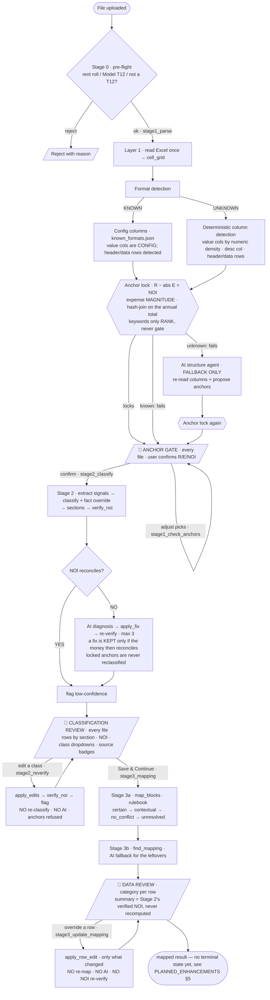

# New Workflow + Data Dry-Run (file upload → mapped result)

Companion to [`../proposals/t12_parsing_proposal.md`](../proposals/t12_parsing_proposal.md)
(the as-built concept). This doc tracks:

1. the **workflow as built** — end to end, upload → anchor gate → classification → mapping →
   data review, including every user re-entry, and
2. a **dry run of the run-state** — the actual JSON produced at each step, so you can see what
   data exists when.

The **data shapes below are real**, captured from `Pointe Inverness T12 11-25.xlsx` (a known
`code_in_a_desc_in_b` file). The Stage-3 slice was captured rulebook-only, so the AI-fallback
fields are annotated rather than shown from that file.

---

## Workflow (as built)

Every arrow labelled `stage*_*` is a **named workflow** in `stages.STEPS` — the only thing a view
may run. There are exactly six, and every one appears below.



**Reading the graph:**

- **The AI is a fallback, never the default.** For unknown files the structure agent runs only if
  the deterministic lock can't reconcile; the diagnosis agent runs only when NOI fails. 23 of 24
  raw seller files lock and reconcile with **no AI at all**.
- **Every fork belongs to the flow**, decided by the data or the arithmetic — never by a caller
  flag. A view picks a workflow by name; it cannot switch part of one off.
- **A re-entry never re-runs the step it re-enters.** `stage2_reverify` and
  `stage3_update_mapping` apply the user's edit onto the reviewed result. Re-running `classify`
  or the mapping would recompute over the edit and silently discard it — the old "Recompute" bug.
- **What a re-entry re-verifies is whatever its edit can break.** A class edit changes which rows
  feed the NOI sum → `verify_noi` runs again. A category is a label and `flip_sign` is an output
  sign convention → no sum moves → nothing to re-verify.

---

## Dry run — the run-state at each step

There is **one `state.json` per upload**, enriched as it goes (`cell_grid` is a heavy side
artifact, stored separately). Below, each step shows the slice(s) it *adds*.

### 1 · Pre-flight  → `state.preflight`

```json
{ "ok": true, "kind": "t12", "reason": "T12 income statement." }
```

`kind` ∈ {t12, rent_roll, model, not_t12}. If `ok:false`, the upload is rejected here.

### 2 · Layer 1 (read Excel once)  → `cell_grid.json` (side artifact)

```
rows=155  (non-empty)   max_row=172   max_col=48
```

Every later step reads this; the workbook is never reopened.

### 3 · Format detection  → `state.format`

```json
{ "format": "code_in_a_desc_in_b", "confidence": 0.698 }
```

`code_in_a_desc_in_b` / `embedded_code_in_a` / `no_code` → **known**; anything else → **unknown**.

### 4 · Resolve columns  → `state.structure_map`  (columns only; anchors + subsections EMPTY)

```json
{ "description_columns": ["B"], "code_column": "A", "code_embedded_in_description": false,
  "value_columns": ["C","D","E","F","G","H","I","J","K","L","M","N","O"],
  "month_header_row": 7, "data_start_row": 10,
  "revenue_end_row": null, "expense_end_row": null, "noi_row": null,
  "validated_subsection_subtotal_rows": [] }
```

- **Known** (shown): columns come from the format template (`build_known_map`).
- **Unknown ✅ (built — [`PLANNED_ENHANCEMENTS.md`](./PLANNED_ENHANCEMENTS.md) §2):**
  `detect_structure_deterministic` reads this *same shape* off the grid (value cols = longest
  numeric run; description = columns left of it minus bare code columns). The **anchor lock is the
  oracle**: if it reconciles, the columns were right and we skip the AI; only a NONE lock falls
  back to the AI agent (which re-produces columns + *proposed* anchors + rich `subsections`, all
  still re-decided by the arithmetic). `state.structure_source` records which path ran. Verified:
  all 7 validated unknown files reconcile deterministically — no AI.

### 5 · Anchor lock (Stage 1)  → `state.anchor_lock`  +  anchors filled into `structure_map`

```json
// state.anchor_lock
{ "status": "AUTO", "method": "auto",
  "candidates": { "revenue": [47], "expense": [170], "noi": [172] },
  "passing":    [ [47, [170], 172] ],
  "anchors":    { "revenue_end_row": 47, "expense_end_row": 170, "noi_row": 172,
                  "expense_split_rows": null } }
// structure_map now: revenue_end_row=47, expense_end_row=170, noi_row=172   (subsections still [])
```

**Arithmetic-first** (done — [`PLANNED_ENHANCEMENTS.md`](./PLANNED_ENHANCEMENTS.md) §1): the
`R − |E| = NOI` math finds every reconciling triple over *all* value-bearing rows (hash-join on
the annual total, `O(n²)`); keywords only **rank** the survivors, they no longer gate which rows
are candidates. So a novel vendor term still locks.

- `status` = **AUTO** (one clear triple, NOI keyword-confirmed) · **DERIVED** (one clear triple,
  but the NOI row carried no NOI keyword — found purely by the math) · **GATE** (several
  contenders tie on keyword-confirmation + revenue magnitude) · **NONE** (nothing reconciled).
- `passing` = the **contenders** only (winner + genuine either/or alternatives, e.g. Carmel's
  single `[157]` vs split `[136,156]`). Coincidental sub-arithmetic triples rank below and are
  dropped so the gate isn't spammed.
- `candidates` = the keyword shortlist (now just the ranker / the gate's pre-populated selects).
- `state.anchor_rows` holds the light `{row, description, values}` list the gate renders.

### 6 · 🛑 Anchor gate → user confirms → `state.anchors`

```json
{ "revenue_end_row": 47, "expense_end_row": 170, "noi_row": 172 }
```

`anchor_lock.status` flips to `MANUAL`. Every file stops here (AUTO just pre-fills it).

### 7 · Classify (Stage 2, on confirm)  → `state.classification`  +  subsections filled

```json
// structure_map gains: "validated_subsection_subtotal_rows": [12,45,64,69,107,112,129,146,157,162,168]
// state.classification:
{ "classified": [
     { "row": 7,  "description": "Account Name",         "class": "METADATA", "section": "metadata", "confidence": 0.25, "low_confidence": false },
     { "row": 10, "description": "Gross Potential Rent", "class": "DATA",     "section": "revenue",  "confidence": 0.20, "low_confidence": false },
     { "row": 47, "description": "Effective Gross Income","class": "SECTION_SUBTOTAL", "section": "revenue", ... },
     ...
  ],
  "noi": { "months": [ ..., { "col": "O", "rev": [3402169, 3402169, true],
                              "exp": [1279404, 1279404, true],
                              "noi": [2122765, 2122765, true] } ],
           "overall_pass": true },
  "low_confidence_rows": [],
  "column_headers": ["Dec 2024", ..., "Total"],
  "diagnosis": null }
```

class distribution: `METADATA=1 · DATA=120 · SUBSECTION_SUBTOTAL=11 · SECTION_SUBTOTAL=4 · COMPUTED_METRIC=1`.
NOI totals: revenue `3,402,169 / 3,402,169` · expense `1,279,404 / 1,279,404` · NOI `2,122,765 / 2,122,765` → **PASS**.
(If NOI had failed, the AI **diagnosis** loop would fill `diagnosis`.)

### 8 · 🛑 Classification review

The page reads `state.classification` directly: NOI verification on top, then every row bucketed
by section (revenue / expense / capex) with its class + confidence, low-confidence rows flagged.
Every non-anchor row carries a **class dropdown**; the locked R / E / NOI rows don't (they're the
target NOI is checked against).

Each classified row also carries its provenance — `source ∈ {auto, ai, manual}` (+ `source_reason`
for AI fixes), which drives the badge and its tooltip. It lives **on the row** because
`save_state` strips the raw `feedback`, so the row is the only thing that reaches the page.
Display only: no behaviour hangs off the tag.

### 8b · Re-verify (`stage2_reverify`) — the user corrects a class

```json
// input:  class_edits = {30: "SUBSECTION_SUBTOTAL"}
// runs:   feedback.apply_corrections(source="manual") → noi.run → classify.run_flag
// output: classification.classified[30].class + .source="manual"; classification.noi recomputed
```

Re-enters the **same `noi` node** the first pass used, so the number on the page is always the
pipeline's number. It does **not** re-classify (that would recompute the scores and overwrite the
edit), does **not** call the AI (it had its turn in `classify`), and does **not** reassign
sections (a section is positional — which side of the locked anchors a row sits on — so a class
edit can't move one). Anchor rows are refused by the workflow, not just hidden by the page.

No lock is needed on an edited row precisely *because* nothing re-runs after an edit.

### 9 · Stage 3 · mapping (on Save & Continue)  → `state.mapping`

`stage3_mapping` = `load_latest_rulebook` → `to_annotated` → `map_blocks` (rulebook) →
`find_mapping` (AI fallback). `state.step` becomes `"mapped"`.

```json
// state.mapping — Pointe Inverness, rulebook-only run
{ "file": "Pointe Inverness T12 11-25.xlsx", "format": "code_in_a_desc_in_b",
  "data_start_row": 9, "column_headers": ["Dec 2024", ..., "Total"],
  "summary": { "total_rows": 137, "data_rows": 120, "anchor_status": "AUTO",
               "mapped": 115, "unmapped": 5 },
  "rows": [
    // a rulebook hit
    { "row": 10, "type": "data", "description": "Gross Potential Rent", "statement_side": "revenue",
      "is_total_revenue": false, "is_total_expense": false, "is_noi": false,
      "mapping": "Gross Potential Rent", "mapping_source": "no_conflict", "not_found": false },

    // the LOCKED anchor rides in as a flag — we map against the rows the user confirmed
    { "row": 172, "type": "subtotal", "description": "NET OPERATING INCOME", "is_noi": true,
      "statement_side": "expense", "mapping": null, "mapping_source": null },

    // what the AI fallback receives: the rulebook's near-misses as context
    { "row": 35, "type": "data", "description": "Miscellaneous Income", "statement_side": "revenue",
      "mapping": null, "not_found": true, "mapping_source": "unresolved",
      "historical_candidate_mappings": ["Other Income Ops", "Utility Rebill - Other"],
      "historical_statement_sides": ["revenue"],
      "historical_section_paths": ["Other Income", "Other Income - Residential", ...] }
  ] }
```

After `find_mapping`, each unresolved row gains **`ai_suggested_mapping`** + **`ai_confidence`**
(`mapping_source: "ai"`). After a user override it gains **`final_mapping`** (+ `flip_sign`).
The three fields are kept side by side — the original recommendation is never overwritten, so
provenance is readable straight off the row.

⚠ Note the row vocabulary here is the **old** one (`type` / `statement_side` / `section_path`),
not the pipeline's (`class` / `section`). That's `legacy_adapter.to_annotated` translating — see
**W5**, and note the `data_review` page reads this vocabulary too.

### 10 · 🛑 Data review

Reads `state.mapping` + `state.classification.noi`. The effective category per row is
`final_mapping ?? mapping ?? ai_suggested_mapping`, so a user override always wins, then the
rulebook, then the AI.

**The bottom summary IS Stage 2's verified NOI** (`classification.noi.months`) — Original NOI,
Calculated NOI, and the per-month red/green all come from it. The page does not re-derive the
money: mapping only assigns categories, so there is nothing for a second opinion to catch. (It
used to, and drifted — it summed `rev − exp` where the pipeline sums `rev − |exp|`, so a vendor
signing expenses negative showed a $730k difference on a file Stage 2 had passed.)

### 10b · Update mapping (`stage3_update_mapping`) — the user overrides a row

```json
// input:  row_edit = {"row": 35, "category": "Other Income Ops"}   // only the CHANGED keys
// runs:   map_blocks.apply_row_edit  (validates the category against the rulebook)
// output: mapping.rows[35].final_mapping   (flip_sign untouched — it wasn't in the edit)
```

The view diffs the POST against current state, because the page posts the whole row every time:
passing both fields through would stamp `final_mapping` — a *user* override — onto a category the
rulebook picked and the user never touched. `category: null` is an explicit "clear my override",
distinct from omitting the key.

---

## Where each field gets filled (quick reference)

| field                                  | filled by                                  | stage |
| -------------------------------------- | ------------------------------------------ | ----- |
| `preflight`                          | pre-flight screen                          | 0     |
| `format`                             | format detection                           | 1     |
| `structure_map` columns              | known config / deterministic detect / AI   | 1     |
| `revenue/expense/noi_row`            | **anchor lock** (arithmetic)         | 1     |
| `anchors` (confirmed)                | **user at the gate**                 | 1→2  |
| `validated_subsection_subtotal_rows` | **arithmetic scan in classify**      | 2     |
| `classification` (rows + noi)        | classify + NOI verify                      | 2     |
| `classification.classified[].class`  | classifier → AI diagnosis → **user** (`stage2_reverify`) | 2 |
| `classification.classified[].source` | `auto` → `ai` (diagnosis) → `manual` (`stage2_reverify`) | 2 |
| `classification.diagnosis`           | the feedback loop (only when NOI failed)   | 2     |
| `mapping.rows[].mapping`             | **rulebook** (`map_blocks`)          | 3a    |
| `mapping.rows[].ai_suggested_mapping` | AI fallback (`find_mapping`), for rulebook misses only | 3b |
| `mapping.rows[].final_mapping` / `flip_sign` | **user at data_review** (`stage3_update_mapping`) | 3 |

**The money is filled exactly once**, by `verify_noi` in stage 2 (`classification.noi`). Nothing
downstream recomputes it; `data_review` displays it.

---

## Module roles (so the layout below makes sense)

- **Every module** exposes `run(state) -> state` (reads its slices, adds its own) **and** the
  underlying **pure function** (takes exactly its inputs — great for unit tests). The pipeline
  uses `run(state)`; tests/scripts can call the pure function.
- **We pass the *whole* state to each step on purpose** — if a step later needs one more slice,
  we change *only that step*, not the view/router.
- **`stages.py`** = the **`STEPS` registry** — the six named workflows, and the **only** thing a
  view may run. Individual module steps are deliberately not exposed: handing a caller raw nodes
  invites it to assemble its own pipeline (skip a node, reorder, re-enter mid-stage), which is how
  the NOI page once wiped the AI's corrections. A new need = a new workflow, never a new handle.
  NOI failure is handled *inside* `stage2_classify` (the diagnosis loop), so no gap exists when a
  stage runs step-by-step.

  | workflow                | triggered by            | does |
  | ----------------------- | ----------------------- | ---- |
  | `stage1_parse`          | upload                  | read → detect → columns → anchor rows → lock |
  | `stage1_check_anchors`  | gate, adjusting picks   | re-verify the user's R/E/NOI (read-only) |
  | `stage2_classify`       | gate confirm            | signals → classify → sections → NOI (+AI on fail) → flags |
  | `stage2_reverify`       | review, class edit      | apply edits → NOI → flags (no re-classify, no AI) |
  | `stage3_mapping`        | review, Save & Continue | rulebook → AI fallback |
  | `stage3_update_mapping` | data review, row edit   | apply the override (no re-map, no AI) |

- **`run_parse.py`** (`parse_file`) = the one-pass **CLI / test runner** (stage1 + classify in
  memory, flattened). The app never calls it.
- **`legacy_adapter.py`** (`to_annotated` + `column_headers`) = the **mapping-input adapter** —
  builds the old `annotated_blocks` shape the mapping stage (and the `data_review` page) still
  consume, in-memory. Retires with **W5**.

---

## Planned work / cleanup (to do)

### W1 · Config-driven known-format templates

Today the known-format columns are **hardcoded constants** in `parsing/signals.py` (`CODE_COL`,
`DESC_COL`, `EMB_DESC_COL`, `NOCODE_DESC_COL`), used only in `structure_map.build_known_map`.
Move them to **`config/known_formats.json`** (+ `config/paths.py` path), so `build_known_map`
loads them and a new format is just a new entry — same pattern as `anchor_keywords.json`:

```json
{ "code_in_a_desc_in_b": { "description_columns":["B"], "code_column":"A",
    "code_embedded_in_description":false, "code_pattern":null, "value_start_column":"C" },
  "embedded_code_in_a":  { "description_columns":["A"], "code_column":null,
    "code_embedded_in_description":true,  "code_pattern":"embedded", "value_start_column":"B" },
  "no_code":             { "description_columns":["A"], "code_column":null,
    "code_embedded_in_description":false, "code_pattern":null, "value_start_column":"B" } }
```

### W2 · Remove the dead old-batch code

The new flow (UI) uses only `parsing/` + `mapping/{map_blocks,find_mapping}` + `config/` +
`build_rulebook/`. The old batch pipeline is **unused** (verified: `parsing/` and `mapping/`
import nothing from it, and `build_rulebook` only *mentions* the manifest in a comment). Delete:
`detection/` (whole), `manifest/` (whole), `run_pipeline.py`, `mapping/run_stage.py`,
`runner_utils.py`, and `utils/` (excel exporters, imported by nothing). Then update
`t12_pipeline/CLAUDE.md` (it still documents the `run_pipeline` batch flow).

### W3 · Reorganize `parsing/` into stage folders

```
parsing/
├── stage1_structure/   cell_grid · signals · format_detect · preflight ·
│                        structure_map · structure_agent · extract · anchor_lock
├── stage2_classify/    classify · sections · noi · feedback
├── stages.py  ·  run_parse.py  ·  legacy_adapter.py
mapping/  → stage3_mapping/   (map_blocks · find_mapping)
```

Mechanical (import refactor only — no data-path changes).

### W4 · Centralize the wiring so a reorg touches one place

- **Data paths** already centralize in `config/paths.py` (keep using it; add `KNOWN_FORMATS_PATH`).
- **Module wiring:** the bridge already calls steps by *name* via `stages.STEPS` (so it's decoupled
  from module locations). Close the last gap by **re-exporting the bridge's few direct helpers
  through the `parsing` package `__init__.py`** (`extract_cell_grid`, `screen_name`,
  `screen_structure`, `to_annotated`) — then W3's reorg updates only `__init__.py` + `stages.py`,
  never the bridge or views. (Python `import` can't be driven from `paths.py`; this is the clean
  equivalent.)

### W5 · Retire `legacy_adapter` (one vocabulary end-to-end) — optional

`legacy_adapter.to_annotated` only exists because the mapping stage still reads the OLD row
vocabulary (`type` / `statement_side` / `section_path`). Not required — it's transitional. To
remove it: (1) **add `section_path` / `section_context` onto the classified rows** in Stage 2 (a
small step that walks the rows and accumulates the SECTION/SUBSECTION-header stack — the logic
`to_annotated` does today), and (2) **update `map_blocks`** to read the new vocabulary
(`class=="DATA"`, `section`, row-level `section_path`). Then the mapping stage reads
`state.classification.rows` directly and `to_annotated` is deleted.

⚠ **Bigger blast radius than "update `map_blocks`".** `state["mapping"]` IS the adapter's output
shape, so the **`data_review` page consumes the old vocabulary too** — `helpers.build_table_rows`
and `compute_summary` read `type=="data"`, `statement_side`, `is_total_revenue` / `is_total_expense`
/ `is_noi`, `section_context`. W5 must therefore update `data_review/helpers.py` + its template in
the same change, or the page silently sums nothing (every `statement_side` lookup returns None →
a $0 "Calculated NOI" that looks plausible). Verify with the data_review summary, not just the
mapping output.

Low priority; risk sits in the AI-heavy mapping stage AND the review page's money math. **Best
done alongside W3** (when we touch `mapping/` → `stage3_mapping/`).
