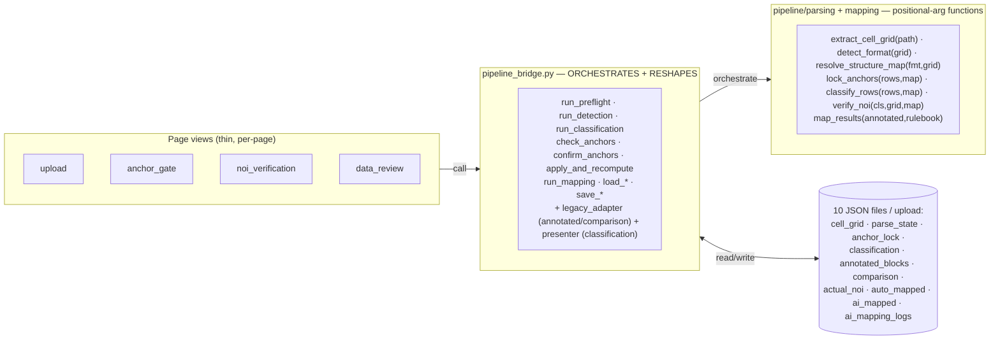
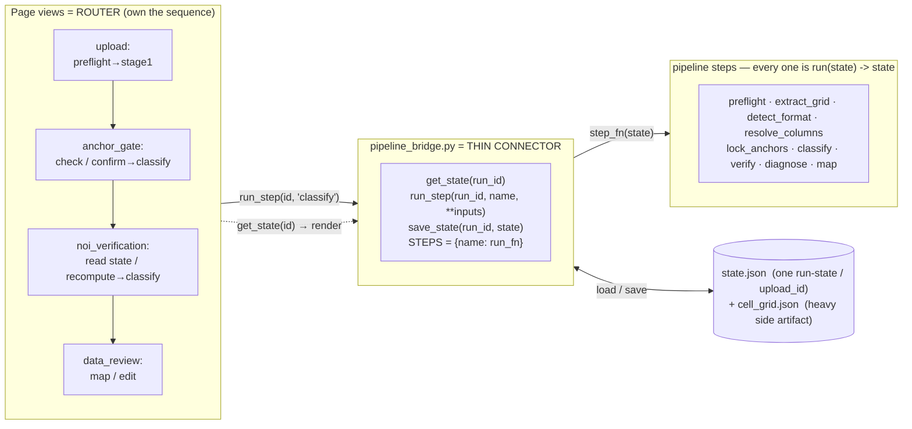

# Restructure Plan — one run-state, dict→dict steps, thin bridge, views as router

**Status:** design for review (not yet built). Cross-cutting: touches `app/t12_pipeline`
(the pipeline modules) **and** `app/ui` (the bridge + page views).

## 1. Goal

Make the pipeline a sequence of uniform, composable steps orchestrated by the views:

- **Every src step is `run(state) -> state`** — reads the slices it needs from one dict,
  adds its own, returns the dict. (Same spirit as the old batch modules: dict in, dict out.)
- **The bridge is just the connection** — load the run-state, run a named step, save it.
  No orchestration, no reshaping.
- **The views are the router** — each page calls the steps it needs, in order, carrying the
  run by `upload_id`, then reads whatever it wants from the returned state to render.

Payoff: to show more in the UI you only tweak a view (the state already holds everything);
to add a pipeline step you write one `run(state)` function and slot it into a view's sequence.

---

## 2. Current architecture (audit)



**What's wrong (relative to the goal):**

1. **The bridge orchestrates.** `run_detection` = extract → detect → resolve → extract_anchor
   → lock → persist. `run_classification` = extract signals → classify → section → NOI →
   diagnosis → persist. The stage sequence lives in the bridge, not the views.
2. **The bridge reshapes.** `legacy_adapter` maps the result onto `annotated_blocks` /
   `comparison` for the mapping stage + old NOI helpers; `presenter` builds `classification.json`.
   A "just the connection" bridge shouldn't transform.
3. **10 fragmented files, with duplication.** `parse_state` carries `final_map`;
   `classification` carries the same anchors; `annotated_blocks` restates the classified rows;
   `comparison` + `actual_noi` restate the NOI. No single source of truth.
4. **Non-uniform module signatures.** `detect_format(grid)`, `lock_anchors(rows, final_map)`,
   `verify_noi(classified, grid, final_map)`, `map_results(annotated, rulebook)` — every step
   has a different positional shape, so they don't compose.

**What's already right (keep):** the pipeline steps are *pure functions* (no Django, no I/O);
pages are isolated and only talk to the bridge; `upload_id` already is the run key.

---

## 3. Target architecture



- **One run-state** (`state.json`) keyed by `upload_id`, accumulating every slice.
- Each **step** reads its inputs from `state`, writes its outputs, returns `state`.
- The **bridge** only does `load → run named step → save`, and hands the view the full state.
- **Views sequence the steps** and read whatever they need from state to render (page-local
  presenters shape state slices for templates — the bridge never reshapes).
- **`cell_grid` stays a separate artifact** (it's multi-MB): the executor injects it into the
  in-memory state for steps that need it and keeps it out of `state.json` for speed.

Page isolation is preserved — views still call **only the bridge** (`run_step` / `get_state`),
never the pipeline directly.

---

## 4. The run-state (single source of truth)

```jsonc
{
  "run_id":  "<upload_id>",
  "file":    { "name": "...", "path": "..." },
  "step":    "screened|locked|confirmed|classified|mapped",   // progress marker

  "preflight":     { "ok": true, "kind": "t12", "reason": "..." },   // step: preflight
  "format":        { "format": "embedded_code_in_a", ... },          // step: detect_format
  "structure_map": { "value_columns": [...], "revenue_end_row": ..., // steps: resolve_columns
                     "expense_split_rows": ..., "validated_subsection_subtotal_rows": [...] },
  "anchor_rows":   [ { "row": 13, "description": "...", "values": [...] } ],  // step: lock_anchors
  "anchor_lock":   { "status": "AUTO", "candidates": {...}, "passing": [...], "anchors": {...} },
  "anchors":       { "revenue_end_row": 68, "expense_end_row": 202, "noi_row": 203,
                     "expense_split_rows": [189,202] },              // written by the gate (user)

  "signals":        [ ...full per-row signal vectors... ],           // step: classify (heavy-ish)
  "classification": { "rows": [ {row, description, class, section, values,
                                 confidence, low_confidence, is_anchor} ],
                      "noi": { months:[...], overall_pass },
                      "low_confidence_rows": [...],
                      "diagnosis": {...} | null },                    // step: classify (+ diagnose)

  "mapping":       { "rows": [ {row, description, mapping, ai_suggested_mapping,
                               final_mapping, flip_sign} ], "summary": {...} }   // step: map
}
```

`cell_grid` is referenced (stored in `cell_grid.json`), not inlined.

---

## 5. Step catalog (new uniform contracts)

Every step is `run(state) -> state`. "reads / writes" = which state slices.

| Step                | reads                             | writes                                                  | wraps today's                                                                                                                                     |
| ------------------- | --------------------------------- | ------------------------------------------------------- | ------------------------------------------------------------------------------------------------------------------------------------------------- |
| `preflight`       | file                              | `preflight`                                           | `screen_name` + `screen_structure`                                                                                                            |
| `extract_grid`    | file.path                         | `cell_grid` (artifact)                                | `extract_cell_grid`                                                                                                                             |
| `detect_format`   | cell_grid                         | `format`                                              | `detect_format`                                                                                                                                 |
| `resolve_columns` | cell_grid, format                 | `structure_map`                                       | `resolve_structure_map` (template / AI agent)                                                                                                   |
| `lock_anchors`    | cell_grid, structure_map          | `anchor_rows`, `anchor_lock`, structure_map.anchors | `extract_anchor_rows` + `lock_anchors`                                                                                                        |
| `check_anchors`   | anchor_rows, anchors              | `reconcile`                                           | `reconcile_triple`                                                                                                                              |
| `classify`        | cell_grid, structure_map, anchors | `signals`, `classification`                         | `extract_row_signals_dynamic` + `classify_rows` + `apply_anchor_overrides` + `assign_sections` + `verify_noi` + `flag_low_confidence` |
| `diagnose`        | classification (on NOI fail)      | classification (corrected)                              | `run_feedback_loop`                                                                                                                             |
| `map`             | classification.rows, rulebook     | `mapping`                                             | `map_results` + `run_ai_mapping`                                                                                                              |

Composite convenience steps (also `run(state)`): **`stage1` = extract_grid→detect_format→
resolve_columns→lock_anchors**; **`stage2` = classify (+diagnose on fail)**. Views can call the
composite or the individual steps — same signature either way.

---

## 6. The thin bridge (target shape)

```python
STEPS = { "preflight": preflight.run, "extract_grid": cell_grid.run, "detect_format": ...,
          "stage1": stages.stage1, "classify": ..., "map": ... }

def get_state(run_id) -> dict: ...
def save_state(run_id, state) -> None: ...

def run_step(run_id, name, **inputs) -> dict:
    state = get_state(run_id)
    state.update(inputs)            # e.g. the user's confirmed anchors
    state = STEPS[name](state)      # dict -> dict
    save_state(run_id, state)
    return state
```

No `legacy_adapter`, no `presenter`, no per-stage persist helpers — those either become steps
that write a state slice, or page-local presenters the views call on state.

---

## 7. Views as the router (examples)

```python
# upload: Stage 0 + Stage 1
pf = bridge.run_step(uid, "preflight", file={"name": name, "path": path})["preflight"]
if not pf["ok"]: reject(pf["reason"])
bridge.run_step(uid, "stage1")
redirect("anchor_gate")

# anchor_gate: re-verify (light) vs confirm (classify)
if action == "verify":
    rc = bridge.run_step(uid, "check_anchors", anchors=chosen)["reconcile"]
else:  # confirm
    bridge.run_step(uid, "classify", anchors=chosen, run_feedback=True)
    redirect("noi_verify")

# noi_verification (review): just read the state and render
state = bridge.get_state(uid)
render(review_presenter(state["classification"], state["anchors"]))
```

The mapping stage reads `state["classification"]["rows"]` directly — `legacy_adapter` retires.
`data_review` reads `state["mapping"]`.

---

## 8. Migration (incremental — app stays working at every phase)

- **Phase A — introduce state + executor (no behaviour change). ✅ DONE.** Added `state.json`
  (+ `cell_grid.json` side artifact) and `get_state/save_state/run_step`. The stage functions
  now live in `parsing/stages.py` as `stage1` / `classify` / `check_anchors`, each `run(state)`
  (Phase A wraps the tested `run_parse` functions). `run_detection`/`run_classification`/
  `check_anchors` are thin callers of `run_step` that ALSO mirror the run-state to the current
  per-page files, so no page breaks. Verified: CLI `parse_file` unchanged on all 7 files; full
  UI flow (upload→gate→re-verify→confirm→review→recompute) identical, incl. split/sign/MANUAL.
- **Phase B — modules to `run(state)`. ✅ DONE.** Every parsing module now exposes its own
  `run(state)` step (`cell_grid` / `format_detect` / `structure_map` / `extract` /
  `anchor_lock` / `classify` / `sections` / `noi` / `feedback`); `stages.py` composes them and
  publishes `STEPS` (the registry the bridge dispatches on). The `run_parse` wrappers are gone —
  `parse_file` (CLI) drives the stages and flattens. Verified: no import cycles, CLI unchanged
  on all 7 files, full UI flow identical.
- **Phase C — views become the router.** Move the stage sequencing out of the bridge into the
  page views (`run_step` calls). The bridge shrinks to `get_state/save_state/run_step` + registry.
- **Phase D — collapse files, retire adapters.** Pages read from `state` via page-local
  presenters; drop `classification/annotated_blocks/comparison/actual_noi` as separate files;
  mapping + `data_review` read `state` slices. `legacy_adapter` deleted.

Each phase is independently shippable and testable against the 7 sample files + the UI flow.

---

## 9. Decisions to confirm before building

1. **Step granularity in views** — expose BOTH composite (`stage1`, `stage2`) and micro steps,
   and let views default to the composite? (Recommended: yes — micro steps stay available for
   when a page needs finer control, but a view normally calls one composite.)
2. **`cell_grid` handling** — keep it a separate side artifact injected on demand (recommended,
   for size), rather than inlining it into `state.json`.
3. **Presenters** — live as **page-local helpers** operating on state slices (recommended, matches
   "views shape their own data"), vs. staying as shared pipeline functions the views call.
4. **Mapping input** — retire `legacy_adapter` and have the map step read `state.classification`
   directly (recommended), accepting we touch `map_blocks` field names (`type`/`statement_side`
   → `class`/`section`).
5. **Scope of this refactor** — pipeline + bridge + the 4 existing pages. The rulebook build
   tool and the old batch `run_pipeline` stay as-is (separate entry points).
