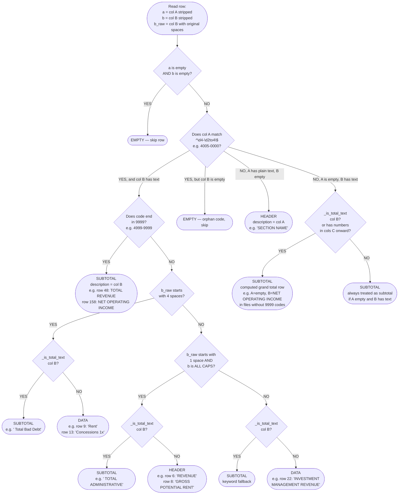

# Row Classification — `code_in_a_desc_in_b` Format

**Files using this format:** Carmel Woods T12 09-25, Pointe Inverness T12 11-25, Willows of Coventry T12 11-25

---

## What the Excel looks like

Every row has an account code in **col A** and a description in **col B**.
The description's leading whitespace in col B is the key structural signal.

```
Col A         Col B
────────────  ──────────────────────────────────
4000-0002     " REVENUE"                ← 1 space + ALL CAPS  →  HEADER
4002-0000     " GROSS POTENTIAL RENT"   ← 1 space + ALL CAPS  →  HEADER
4005-0000     "    Rent"                ← 4 spaces            →  DATA
4006-0000     "    Loss or Gain to Lease"                      →  DATA
4099-9999     "TOTAL GROSS POTENTIAL RENT"  ← 9999 code       →  SUBTOTAL
4400-0000     "INVESTMENT MANAGEMENT REVENUE"  ← no indent    →  DATA
4999-9999     "TOTAL REVENUE"           ← 9999 code           →  SUBTOTAL (EGI flip)
6999-9999     "NET OPERATING INCOME"    ← 9999 code           →  SUBTOTAL (NOI flip)
```

The checks happen **in strict order** — the first matching branch wins and the row is returned immediately. Later branches are never evaluated.

---

## Decision Tree



---

## Step-by-step with real Carmel Woods rows

The key thing to understand: **each check is an early return**. Once a branch matches, the function exits immediately. The row never reaches later checks.

### Row 21 (empty row)
```
Col A = ""    Col B = ""
→ Step 1: both empty → EMPTY  ✓  (never reaches any other check)
```

### Row 9 — `"4005-0000"` / `"    Rent"` → DATA
```
Step 1: not both empty           → continue
Step 2: "4005-0000" matches ^\d{4}-\d{2,4}$  → has_code = True
        col B = "    Rent" (non-empty)         → enter the has_code+b branch
Step 3: "4005-0000" ends in 9999? No           → continue
Step 4: b_raw = "    Rent" starts with 4 spaces? YES → enter 4-space branch
        _is_total_text("Rent")? No             → DATA, "Rent"  ✓
```

### Row 6 — `"4000-0002"` / `" REVENUE"` → HEADER
```
Step 1: not both empty           → continue
Step 2: "4000-0002" matches      → has_code = True, col B non-empty
Step 3: ends in 9999? No         → continue
Step 4: b_raw = " REVENUE"
        starts with 4 spaces? No → skip
        starts with 1 space AND "REVENUE".upper() == "REVENUE"? YES → enter 1-space+CAPS branch
        _is_total_text("REVENUE")? No → HEADER, "REVENUE"  ✓
```

### Row 11 — `"4099-9999"` / `"TOTAL GROSS POTENTIAL RENT"` → SUBTOTAL
```
Step 1: not both empty           → continue
Step 2: "4099-9999" matches      → has_code = True, col B non-empty
Step 3: ends in 9999? YES        → SUBTOTAL, "TOTAL GROSS POTENTIAL RENT"  ✓
        (function exits here — never checks indentation or keywords)
```

### Row 20 — `"4399-9999"` / `"NET RENT REVENUE"` → SUBTOTAL
```
Step 3: "4399-9999" ends in 9999? YES
        → SUBTOTAL, "NET RENT REVENUE"  ✓
        (Note: no "Total" prefix but the 9999 code catches it anyway — no keywords needed)
```

### Row 22 — `"4400-0000"` / `"INVESTMENT MANAGEMENT REVENUE"` → DATA
```
Step 2: has_code = True, col B non-empty
Step 3: ends in 9999? No
Step 4: b_raw = "INVESTMENT MANAGEMENT REVENUE"
        starts with 4 spaces? No → skip
        starts with 1 space? No  → skip  (no leading space at all)
        _is_total_text("INVESTMENT MANAGEMENT REVENUE")? No → DATA  ✓
```

### Row 48 — `"4999-9999"` / `"TOTAL REVENUE"` → SUBTOTAL  ← **EGI (income phase flip)**
```
Step 3: "4999-9999" ends in 9999? YES
        → SUBTOTAL, "TOTAL REVENUE"  ✓
        (detect_blocks state machine then sees "total revenue" in GRAND_INCOME_TOTAL_MARKERS
         and flips income_phase_complete = True — all rows after this become expense)
```

### Row 158 — `"6999-9999"` / `"NET OPERATING INCOME"` → SUBTOTAL  ← **NOI flip**
```
Step 3: "6999-9999" ends in 9999? YES
        → SUBTOTAL, "NET OPERATING INCOME"  ✓
        (detect_blocks state machine sees "net operating income" in GRAND_NOI_MARKERS
         and flips capex_phase_complete = True — all rows after this become capex)
```

---

## Why the 9999 code is the most reliable signal

In Carmel Woods, every single section total has a `xxxx-9999` code.
This covers: `TOTAL GROSS POTENTIAL RENT`, `NET RENT REVENUE`, `TOTAL REVENUE`, `NET OPERATING INCOME` — none of these need keyword matching to be classified as SUBTOTAL.

The keyword path (`_is_total_text`) only fires for:
- 4-space-indented rows whose description starts with "Total" (e.g. `    Total Bad Debt Recovery`)
- Edge-case fallback rows with no indentation pattern

---

## Where keywords are actually needed

| Scenario | Example | Why keyword needed |
|---|---|---|
| 4-space row with "Total" in description | `    Total Bad Debt Recovery` | Indented + "Total " prefix → `_is_total_text` detects it |
| Empty A + exotic grand total label | A="", B="Collectible Rental Revenue" | No 9999 code, no "Total" prefix → numeric fallback |
| 1-space ALL-CAPS total | ` TOTAL CONTROLLABLE EXPENSES` | Caught by `_is_total_text` after 1-space+CAPS branch |

In practice, the 9999 code handles every **structural section boundary** in this format.
Keywords are a safety net for intermediate subtotals and exotic labels, not the primary signal.
