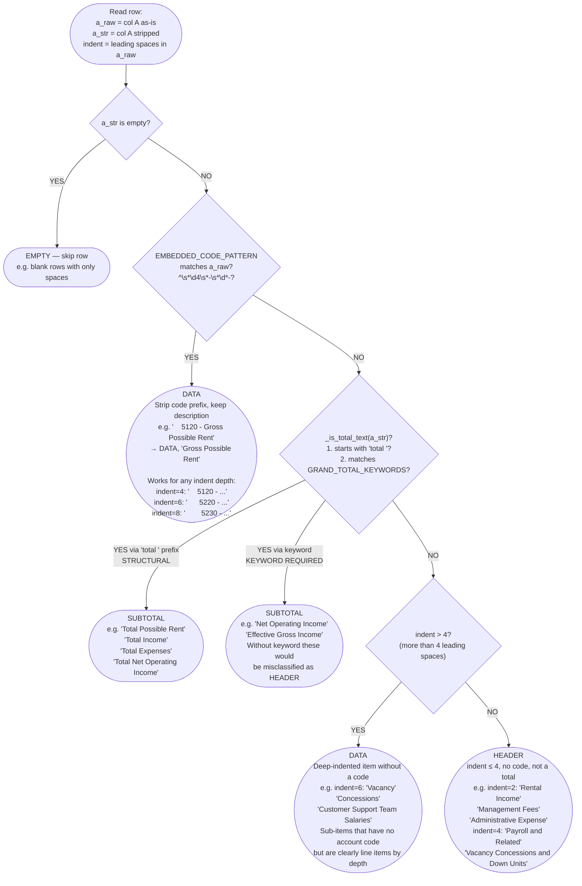

# Row Classification — `embedded_code_in_a` Format

**Files using this format:** Brownsburg Crossing T12 05-25, Pebble Brook Village T12 03-25, Pebble Brook Village T12 09-25

---

## What the Excel looks like

Everything is in **col A only**. Col B is unused for classification.
The account code and description are merged into a single cell — the code is stripped out, leaving the description.

```
Col A (raw cell value)                              → Classification
──────────────────────────────────────────────────────────────────────
'  Rental Income'                   indent=2         → HEADER
'    5120 - Gross Possible Rent'    indent=4, code   → DATA  (stripped: "Gross Possible Rent")
'    5121 - Loss to Old Lease'      indent=4, code   → DATA
'  Total Possible Rent'             indent=2, "Total"→ SUBTOTAL
'  Other Income'                    indent=2         → HEADER
'  Total Income'                    indent=2, "Total"→ SUBTOTAL  ← EGI flip
'  Net Operating Income'            indent=2, keyword→ SUBTOTAL  ← NOI flip  ★ keyword needed
```

**Pebble Brook 09-25 adds a deeper hierarchy** — subsections nest with indent=6:

```
'    Vacancy, Concessions, & Down Units'  indent=4, no code  → HEADER  (indent ≤ 4)
'      Vacancy'                           indent=6, no code  → DATA    (indent > 4)
'        5220 - Vacancies'                indent=8, code     → DATA
'      Total Vacancy'                     indent=6, "Total"  → SUBTOTAL
'  Effective Gross Income'                indent=2, keyword  → SUBTOTAL ← EGI flip ★ keyword needed
'  Total Net Operating Income'            indent=2, "Total"  → SUBTOTAL ← NOI flip (structural)
```

---

## Decision Tree



---

## Step-by-step with real rows

The checks run **in order, first match exits**. Later checks are never evaluated.

### Brownsburg Crossing T12 05-25

#### Row 12 — `'  Rental Income'` (indent=2, no code) → HEADER
```
Step 1: a_str = "Rental Income"  (not empty)           → continue
Step 2: EMBEDDED_CODE_PATTERN.match('  Rental Income')? No  → continue
Step 3: _is_total_text("Rental Income")?
          starts with "total "? No
          in GRAND_TOTAL_KEYWORDS? No                  → continue
Step 4: indent > 4?  indent=2, No                      → continue
Step 5: a_str non-empty                                → HEADER, "Rental Income"  ✓
```

#### Row 13 — `'    5120 - Gross Possible Rent'` (indent=4, has code) → DATA
```
Step 1: a_str = "5120 - Gross Possible Rent"           → continue
Step 2: EMBEDDED_CODE_PATTERN.match('    5120 - ...')? YES
          → strip code prefix: "Gross Possible Rent"
          → DATA, "Gross Possible Rent"  ✓  (exits here)
```

#### Row 16 — `'  Total Possible Rent'` (indent=2, "Total" prefix) → SUBTOTAL
```
Step 2: EMBEDDED_CODE_PATTERN? No                      → continue
Step 3: _is_total_text("Total Possible Rent")?
          starts with "total "? YES
          → SUBTOTAL, "Total Possible Rent"  ✓  (exits here — no keyword needed)
```

#### Row 61 — `'  Total Income'` (indent=2) → SUBTOTAL  ←  **EGI, income phase flip**
```
Step 3: _is_total_text("Total Income")?
          starts with "total "? YES
          → SUBTOTAL, "Total Income"  ✓

  detect_blocks state machine then sees "total income" in GRAND_INCOME_TOTAL_MARKERS
  → income_phase_complete = True
  → all data rows after this → statement_side = "expense"
```

#### Row 203 — `'  Net Operating Income'` (indent=2) → SUBTOTAL  ←  **NOI flip  ★ keyword required**
```
Step 2: EMBEDDED_CODE_PATTERN? No                      → continue
Step 3: _is_total_text("Net Operating Income")?
          starts with "total "? No
          in GRAND_TOTAL_KEYWORDS? "net operating income" → YES
          → SUBTOTAL, "Net Operating Income"  ✓

  Without this keyword it would reach:
  Step 4: indent > 4?  indent=2, No
  Step 5: a_str non-empty → HEADER  ✗  (WRONG — would break statement_side for all capex rows)
```

---

### Pebble Brook Village T12 09-25 (deeper hierarchy)

#### Row 19 — `'    Vacancy, Concessions, & Down Units'` (indent=4, no code) → HEADER
```
Step 2: EMBEDDED_CODE_PATTERN? No
Step 3: _is_total_text("Vacancy, Concessions, & Down Units")? No
Step 4: indent > 4?  indent=4, No                    → continue
Step 5: a_str non-empty → HEADER  ✓  (sub-section heading)
```

#### Row 20 — `'      Vacancy'` (indent=6, no code) → DATA
```
Step 3: _is_total_text("Vacancy")? No
Step 4: indent > 4?  indent=6, YES
        → DATA, "Vacancy"  ✓  (sub-item without code, caught by depth)
```

#### Row 22 — `'      Total Vacancy'` (indent=6, "Total" prefix) → SUBTOTAL
```
Step 3: _is_total_text("Total Vacancy")?
          starts with "total "? YES
          → SUBTOTAL  ✓  (exits BEFORE the indent check — "Total" always wins)
```

#### Row 68 — `'  Effective Gross Income'` (indent=2) → SUBTOTAL  ←  **EGI flip  ★ keyword required**
```
Step 2: EMBEDDED_CODE_PATTERN? No
Step 3: _is_total_text("Effective Gross Income")?
          starts with "total "? No
          in GRAND_TOTAL_KEYWORDS? "effective gross income" → YES
          → SUBTOTAL  ✓

  Without keyword:
  Step 4: indent > 4? indent=2, No
  Step 5: → HEADER  ✗  (WRONG — income phase would never flip,
                          all expense rows would be misclassified as revenue)
```

#### Row 203 — `'  Total Net Operating Income'` (indent=2) → SUBTOTAL  ← **NOI flip (structural)**
```
Step 3: _is_total_text("Total Net Operating Income")?
          starts with "total "? YES
          → SUBTOTAL  ✓  (structural — no keyword needed here,
                           unlike Brownsburg's "Net Operating Income")
```

---

## The indent boundary: HEADER vs DATA for no-code rows

The `indent > 4` rule is the only thing separating a sub-section header from an unnamed data item:

```
indent ≤ 4 + no code + not total  →  HEADER   (section heading)
indent > 4 + no code + not total  →  DATA     (unnamed line item)

Brownsburg:
  indent=2  "  Management Fees"           → HEADER
  indent=4  "    5120 - Gross ..."        → DATA  (via code match, not indent)

Pebble Brook:
  indent=4  "    Payroll & Related"       → HEADER  (sub-section)
  indent=6  "      Vacancy"              → DATA    (no code but deep enough)
  indent=8  "        5220 - Vacancies"   → DATA    (via code match)
```

---

## Where keywords are needed vs not needed

| Row example | Classification path | Keyword needed? |
|---|---|---|
| `5120 - Gross Possible Rent` | EMBEDDED_CODE_PATTERN matches | **No** — structural |
| `Total Possible Rent` | starts with "total " | **No** — structural |
| `Total Net Operating Income` | starts with "total " | **No** — structural |
| `Rental Income` (indent=2) | not code, not total, indent ≤ 4 | **No** — structural |
| `Vacancy` (indent=6, no code) | indent > 4 | **No** — structural |
| `Net Operating Income` (indent=2) | NOT "total " prefix → needs keyword | **YES — critical** |
| `Effective Gross Income` (indent=2) | NOT "total " prefix → needs keyword | **YES — critical** |

The two keyword-dependent rows are also the two state machine flip triggers.
If either keyword is missing or the vendor uses a different label, the phase flip never happens
and every row after it gets the wrong `statement_side`.
