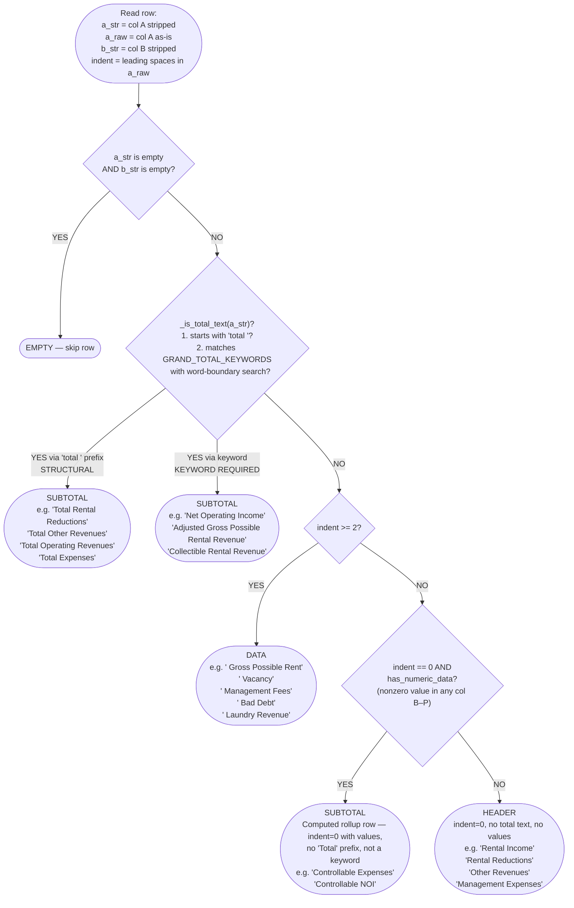

# Row Classification — `no_code` Format

**Files using this format:** Echo Park T12

---

## What the Excel looks like

Everything is in **col A only**. No account codes anywhere.
Classification is purely indent-based, with two fallbacks for zero-indent totals.

```
Col A (raw cell value)                                    → Classification
──────────────────────────────────────────────────────────────────────────
'Rental Income'                          indent=0        → HEADER
'  Gross Possible Rent'                  indent=2        → DATA
'  Vacancy'                              indent=2        → DATA
'Adjusted Gross Possible Rental Revenue' indent=0, kw    → SUBTOTAL  ← intermediate (no flip)
'Rental Reductions'                      indent=0        → HEADER
'  Bad Debt'                             indent=2        → DATA
'Total Rental Reductions'                indent=0, "Tot" → SUBTOTAL
'Collectible Rental Revenue'             indent=0, kw    → SUBTOTAL  ← intermediate (no flip)
'Other Revenues'                         indent=0        → HEADER
'  Laundry Revenue'                      indent=2        → DATA
'Total Other Revenues'                   indent=0, "Tot" → SUBTOTAL
'Total Operating Revenues'               indent=0, "Tot" → SUBTOTAL  ← EGI flip
'Management Expenses'                    indent=0        → HEADER
'  Management Fees'                      indent=2        → DATA
'  Payroll'                              indent=2        → DATA
'Controllable Expenses'                  indent=0, nums  → SUBTOTAL  ← numeric fallback
'Controllable NOI'                       indent=0, nums  → SUBTOTAL  ← numeric fallback
'Net Operating Income'                   indent=0, kw    → SUBTOTAL  ← NOI flip  ★ keyword needed
```

This format has **three detection paths** for subtotals — more than either other format:
1. Keyword match (`GRAND_TOTAL_KEYWORDS`) — catches totals without "Total" prefix
2. `"total "` prefix — structural, no keyword needed
3. **Numeric fallback** — indent=0 with nonzero values in data columns — unique to this format

---

## Decision Tree



---

## Step-by-step with real Echo Park rows

The checks run **in order, first match exits**. Later checks are never evaluated.

### Row 6 — `'Rental Income'` (indent=0, no total, no numbers) → HEADER
```
Step 1: a_str = "Rental Income"  (not empty)             → continue
Step 2: _is_total_text("Rental Income")?
          starts with "total "? No
          in GRAND_TOTAL_KEYWORDS? No                    → continue
Step 3: indent >= 2?  indent=0, No                       → continue
Step 4: has_numeric_data?  No (header row, no values)    → continue
Step 5: indent=0, a_str non-empty                        → HEADER, "Rental Income"  ✓
```

### Row 7 — `'  Gross Possible Rent'` (indent=2) → DATA
```
Step 1: a_str = "Gross Possible Rent"  (not empty)       → continue
Step 2: _is_total_text("Gross Possible Rent")?
          starts with "total "? No
          in GRAND_TOTAL_KEYWORDS? No                    → continue
Step 3: indent >= 2?  indent=2, YES
        → DATA, "Gross Possible Rent"  ✓  (exits here — never reaches numeric check)
```

### Row 10 — `'Adjusted Gross Possible Rental Revenue'` (indent=0, keyword) → SUBTOTAL  ←  **intermediate revenue subtotal, no flip**
```
Step 2: _is_total_text("Adjusted Gross Possible Rental Revenue")?
          starts with "total "? No
          in GRAND_TOTAL_KEYWORDS? "adjusted gross possible rental revenue" → YES
          → SUBTOTAL, "Adjusted Gross Possible Rental Revenue"  ✓

  detect_blocks then checks: "adjusted gross possible rental revenue"
    in GRAND_INCOME_TOTAL_MARKERS? {"total income", "total revenue",
                                    "effective gross income", "total operating revenues"}
    → NO — income_phase_complete stays False
  → statement_side = "revenue" (pre-flip, as expected for an intermediate income subtotal)

  Without "adjusted gross possible rental revenue" in GRAND_TOTAL_KEYWORDS:
  Step 3: indent >= 2?  indent=0, No
  Step 4: has_numeric_data?  YES (this is a computed row with formula values)
  → SUBTOTAL via numeric fallback  ✓  (type classification still correct!)

  The keyword in GRAND_TOTAL_KEYWORDS is redundant for TYPE detection here —
  the numeric fallback catches it anyway. The keyword only matters if a file
  has this row with no values (which doesn't happen in practice).
```

### Row 17 — `'Total Rental Reductions'` (indent=0, "Total" prefix) → SUBTOTAL
```
Step 2: _is_total_text("Total Rental Reductions")?
          starts with "total "? YES
          → SUBTOTAL, "Total Rental Reductions"  ✓  (exits here — no keyword needed)
```

### Row 21 — `'Collectible Rental Revenue'` (indent=0, keyword) → SUBTOTAL  ←  **intermediate revenue subtotal, no flip**
```
Step 2: _is_total_text("Collectible Rental Revenue")?
          starts with "total "? No
          in GRAND_TOTAL_KEYWORDS? "collectible rental revenue" → YES
          → SUBTOTAL, "Collectible Rental Revenue"  ✓

  detect_blocks: "collectible rental revenue" not in GRAND_INCOME_TOTAL_MARKERS
  → income_phase_complete stays False — this is still the revenue phase
```

### Row 58 — `'Total Operating Revenues'` (indent=0, "Total" prefix) → SUBTOTAL  ←  **EGI flip**
```
Step 2: _is_total_text("Total Operating Revenues")?
          starts with "total "? YES
          → SUBTOTAL, "Total Operating Revenues"  ✓

  detect_blocks then checks: "total operating revenues"
    in GRAND_INCOME_TOTAL_MARKERS? YES
    → income_phase_complete = True  ✓
  statement_side for this subtotal = "revenue"  (captured BEFORE the flip)
  → all data rows after this → statement_side = "expense"

  No keyword needed for the flip — "total " prefix catches it structurally.
  The income flip is entirely structural for Echo Park.
```

### Row 59 — `'Management Expenses'` (indent=0, no total, no numbers) → HEADER
```
Step 2: _is_total_text("Management Expenses")?  No       → continue
Step 3: indent >= 2?  indent=0, No                       → continue
Step 4: has_numeric_data?  No (header row, no values)    → continue
Step 5: indent=0, a_str non-empty                        → HEADER, "Management Expenses"  ✓

  income_phase_complete is now True → next data rows will be "expense"
```

### Row 217 — `'Controllable Expenses'` (indent=0, no total text, has values) → SUBTOTAL  ←  **numeric fallback**
```
Step 2: _is_total_text("Controllable Expenses")?
          starts with "total "? No
          in GRAND_TOTAL_KEYWORDS? No                    → continue
Step 3: indent >= 2?  indent=0, No                       → continue
Step 4: has_numeric_data?  YES (row has monthly formula values)
        → SUBTOTAL, "Controllable Expenses"  ✓

  This row would be misclassified as HEADER without the numeric fallback:
  Step 5: indent=0, a_str non-empty → HEADER  ✗
  (statement_side would be wrong and the UI subtotal would be missing)

  The numeric fallback is why: this row looks structurally like a header
  (indent=0, no code, no "Total") but carries actual values in the sheet.
  The check `has_numeric_data` distinguishes computed rollup rows from
  section headings purely from the sheet data — no keyword needed.
```

### Row 218 — `'Controllable NOI'` (indent=0, no total text, has values) → SUBTOTAL  ←  **numeric fallback**
```
Step 2: _is_total_text("Controllable NOI")?  No          → continue
Step 3: indent >= 2?  indent=0, No                       → continue
Step 4: has_numeric_data?  YES
        → SUBTOTAL, "Controllable NOI"  ✓  (same mechanism as row 217)

  detect_blocks: "controllable noi" not in GRAND_NOI_MARKERS {"net operating income"}
  → capex_phase_complete stays False — we're still in the expense phase
```

### Row 228 — `'Net Operating Income'` (indent=0, keyword) → SUBTOTAL  ←  **NOI flip  ★ keyword required**
```
Step 2: _is_total_text("Net Operating Income")?
          starts with "total "? No
          in GRAND_TOTAL_KEYWORDS? "net operating income" → YES
          → SUBTOTAL, "Net Operating Income"  ✓

  detect_blocks then checks (after income_phase_complete=True):
    "net operating income" in GRAND_NOI_MARKERS? YES
    → capex_phase_complete = True  ✓
  statement_side for this subtotal = "expense"  (captured BEFORE the NOI flip)
  → all data rows after this → statement_side = "capex"

  Without "net operating income" in GRAND_TOTAL_KEYWORDS:
  Step 3: indent >= 2?  indent=0, No
  Step 4: has_numeric_data?  YES (NOI row has values)
  → SUBTOTAL via numeric fallback  ✓  (TYPE still correctly classified!)

  BUT the phase flip in detect_blocks still needs GRAND_NOI_MARKERS to fire:
    "net operating income" in GRAND_NOI_MARKERS? → depends on keywords
  → Without the keyword in GRAND_NOI_MARKERS, capex_phase_complete never flips
  → Every row after NOI would get statement_side = "expense"
  → All capex/below-the-line rows would be included in expense computation
  → computed NOI would be wrong — NOI verification would fail
```

---

## The numeric fallback: what makes `no_code` different

The `code_in_a_desc_in_b` format uses the `xxxx-9999` account code as a structural signal for section totals. The `embedded_code_in_a` format uses the `EMBEDDED_CODE_PATTERN` to separate data rows from headers. The `no_code` format has no codes at all — the only signals are indentation and text.

This creates a gap: Excel sheets sometimes have **rollup rows** that look structurally like headers (indent=0, no "Total" prefix, no keyword) but actually carry computed formula values across the month columns. The numeric fallback closes this gap:

```
indent=0 + no "total" prefix + no keyword + has nonzero values → SUBTOTAL
```

In Echo Park this catches `'Controllable Expenses'` (row 217) and `'Controllable NOI'` (row 218). Without it they would be misclassified as HEADER, producing phantom header rows with no data and missing subtotals in the UI.

---

## Type classification vs phase flip: two separate mechanisms

This is the critical distinction for `no_code` files:

**Type classification** (`classify_row` → `"subtotal"` / `"data"` / `"header"`) has the numeric fallback as a safety net. A row can be correctly typed as SUBTOTAL via:
- keyword in GRAND_TOTAL_KEYWORDS
- "total " prefix
- numeric fallback (indent=0, has values)

**Phase flip** (`detect_blocks` state machine → `income_phase_complete`, `capex_phase_complete`) has **no fallback**. It depends entirely on keywords in `GRAND_INCOME_TOTAL_MARKERS` and `GRAND_NOI_MARKERS`. Even if a row is correctly typed as SUBTOTAL via numeric fallback, the flip only fires when the description matches a marker.

For Echo Park specifically:
- Income flip row (`'Total Operating Revenues'`) → structural, no keyword needed (caught by "total " prefix and present in GRAND_INCOME_TOTAL_MARKERS)
- NOI flip row (`'Net Operating Income'`) → keyword-critical for the flip, even though numeric fallback would catch it as SUBTOTAL

```
"Net Operating Income" correctly typed as SUBTOTAL:  keyword  OR  numeric fallback
capex_phase_complete flip fires:                      keyword ONLY  (GRAND_NOI_MARKERS)
```

---

## Where keywords are needed vs not needed

| Row example | Classification path | Keyword for type? | Keyword for flip? |
|---|---|---|---|
| `  Gross Possible Rent` (indent=2) | indent >= 2 | **No** — structural | — |
| `Total Rental Reductions` | starts with "total " | **No** — structural | — |
| `Total Operating Revenues` | starts with "total " | **No** — structural | **No** — "total operating revenues" in GRAND_INCOME_TOTAL_MARKERS |
| `Controllable Expenses` (indent=0, has values) | numeric fallback | **No** — structural | — |
| `Controllable NOI` (indent=0, has values) | numeric fallback | **No** — structural | — |
| `Adjusted Gross Possible Rental Revenue` | keyword OR numeric fallback | Redundant — fallback covers it | No flip triggered |
| `Collectible Rental Revenue` | keyword OR numeric fallback | Redundant — fallback covers it | No flip triggered |
| `Net Operating Income` (indent=0) | keyword OR numeric fallback | Redundant — fallback covers it | **YES — critical** |

The income flip for Echo Park is entirely structural (no keyword dependency). Only the NOI flip requires a keyword, and it's already in `GRAND_NOI_MARKERS` since it's shared across all three formats.

If a vendor renames "Net Operating Income" to something else (e.g. "Net Income from Operations"), the type classification would still work (numeric fallback), but `capex_phase_complete` would never flip, and all rows after NOI would get `statement_side = "expense"` — breaking NOI computation for every file with below-the-line items.
