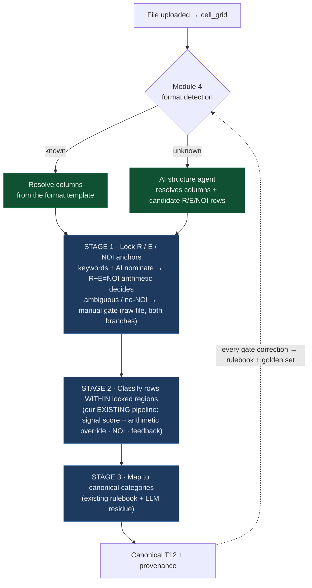
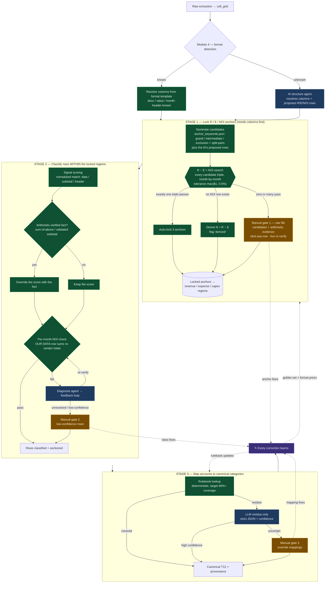

# Anchor-first workflow (proposed)

**Status:** under discussion — the client's 3-stage redesign, plus one addition on our
side (the AI structure agent as an anchor-candidate source). The *current* pipeline
diagram still lives in [t12_parsing_proposal.md](./t12_parsing_proposal.md); this file
shows what it would become if we adopt the anchor-first design.

**Build status (2026-07-11):** Phase 1 (unknown branch) is **implemented and tested** in the notebook — a new `Module 9b` anchor lock (`lock_anchors`, driven by `anchor_keywords.json`), the `apply_anchor_overrides` fact-override after Module 10, Module 11 reduced to a positional tag from the locked anchors, and the feedback loop constrained so it can't touch locked rows. On the 7-file unknown set: **6 auto-lock to the correct anchors and reconcile with no feedback loop; Eleven11 flags GATE (4 valid triples — genuinely ambiguous) and still reconciles.** Phase 2 (known branch) is not built yet.

---

## At a glance — same 3 stages as the client's, one box each

**The key sequencing point (validated against our code):** the R−E=NOI lock needs the value
columns first, so **column resolution comes before Stage 1** — from the format template on the
known branch, from the AI structure agent on the unknown branch (a deterministic column detector
was tried and dropped; it grabbed wrong columns like a "Variance" column). So the anchor-lock sits
right after column resolution, not "before every step."

That's the whole thing — no more complex than the current pipeline. The **detailed view**
below is the *same* three stages with every decision branch drawn out (auto-lock vs manual,
override yes/no, NOI pass/fail); it only looks busier because it zooms in. You do not have to
adopt all of it — Stage 2 is already built, Stage 3 already exists, and the three gates +
learning loop are optional product layers that can come later.

## Detailed view — every decision branch

Legend: **green** = automatic/deterministic · **blue** = AI · **amber** = manual gate (fallback) · **purple** = learning loop.

---

## What changes vs the current workflow

| Today (current diagram)                                                              | Anchor-first (proposed)                                                                                            |
| ------------------------------------------------------------------------------------ | ------------------------------------------------------------------------------------------------------------------ |
| AI structure agent proposes R/E/NOI, we trust it, validate later                     | R/E/NOI**locked first** via arithmetic search over candidates; classification runs *inside* locked regions |
| Section tag assigned**after** classification (Module 11 keyword state machine) | Section is just "which region between anchors" —**state machine deleted**                                   |
| Classifier is a pure signal score                                                    | Score**plus** an arithmetic-fact override (our deferred override layer)                                      |
| Human review is effectively per-file                                                 | Three**exception-triggered** gates; humans only touch ambiguous cases                                        |
| No learning loop                                                                     | Every gate correction feeds the rulebook + a golden test set                                                       |
| Canonical mapping = existing src stage                                               | Same, now framed as Stage 3                                                                                        |

The genuinely **new** build: Stage 1 (candidate pool + R−E=NOI lock), the Stage 2 fact-override,
the three gates, and the learning loop. Stage 2's classifier/arithmetic/diagnosis and Stage 3's
rulebook mapping **already exist**.

---

## Key clarifications (the things that are easy to get wrong)

### The candidate pool must be multi-source, or it isn't dynamic

The client's Stage 1 draws candidates from **template + keyword** only. On a truly unknown
format (code-only totals like `…099/…999`, "Net Rental Revenue", abbreviations) no keyword
fires, so no triple can be tested → it drops to Manual gate 1 **every** unknown file. Fix:
add the **AI structure agent** (which already auto-locks unknown layouts, 7/7 on the test set)
as a third candidate source. The R−E=NOI arithmetic test itself is fully format-agnostic; only
the *shortlist* was biased.

### There are TWO different NOI checks — they are not the same

- **Stage 1 check** — `R − E = NOI` on the **vendor's own 3 grand-total rows**. Purpose: pick
  the anchors *and* detect whether the vendor's totals are internally consistent. Does not use
  our row classification at all.
- **Stage 2 check** — sum of the rows **we** labeled DATA, per section, vs the vendor totals,
  per month. Purpose: validate *our classification* inside the locked regions.

### Anchors do NOT replace classification

Locking R/E/NOI only fixes the **region boundaries** (revenue-side vs expense-side vs capex).
It says nothing about which rows inside a region are data / subtotal / header — so the full
classifier still runs; it just runs on known-good regions.

### What "manual override = fallback, not primary" means

Today the **human** is the mechanism that catches a wrong anchor (they eyeball/fix every file).
In the new design the **arithmetic** is that mechanism; the human's active correction only fires
when auto-lock fails. The user is still *shown* the result ("lock … and send to UI"); on clean
files it's a confirmation glance rather than active editing.

### Failure handling

- **Stage 1, zero triples pass** → AI resolve → manual pick. If it's zero because the **vendor's
  own numbers are inconsistent**, manual can identify the 3 rows but the math still won't
  reconcile → flagged as a **DATA_PROBLEM** (vendor error), not auto-fixable.
- **Stage 1, multiple triples pass** → ambiguous → AI resolve → manual disambiguate. Testing
  month-by-month (not just the annual total) makes coincidental multiples rare; keeping
  candidates to **grand-total-level** rows (not every subtotal) reduces them further.
- **Stage 2 NOI fails** → diagnosis agent + feedback loop reclassify until it reconciles (no
  human needed for the common case).

---

## Open decisions for us + the client

1. **Auto-lock approval:** on a clean auto-locked file, hard "user must click approve," or flow
   straight through? (liability vs throughput)
2. **Candidate sources:** confirm Stage 1 = Template ∪ Keyword ∪ **AI agent** (not keyword-only).
3. **Gate triggering:** confirm the three gates are exception-only, not mandatory per file.
