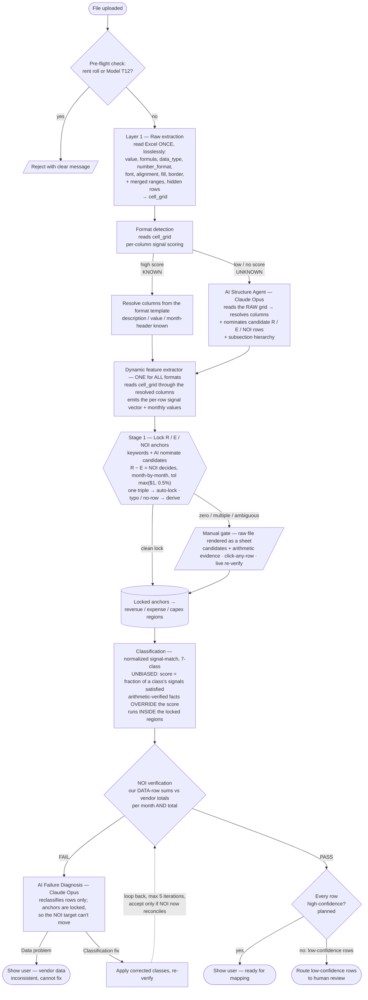

# New T12 Parsing Approach

A single workflow that handles any layout (known or new), self-corrects misclassifications, and fails honestly when the vendor's own data is inconsistent.

> **Anchor-first front end.** The R / E / NOI anchors are **locked up front (Stage 1)** by an arithmetic `R − E = NOI` test over keyword + AI candidates — *before* row classification — so classification runs inside known-good regions and the old post-classification section state machine is gone. The detailed Stage-1 breakdown, its failure modes, and the open decisions live in [anchor_first_workflow.md](./anchor_first_workflow.md).

---

## Workflow

> **`cell_grid` is the single source of truth.** Layer 1 reads the Excel exactly once and dumps it losslessly; **format detection, every Layer 2 extractor, and the render-for-agent step all read `cell_grid`** — nothing reopens the workbook.
>
> **One extractor for every format.** Known and unknown files run the **same dynamic feature extractor** — it just reads `cell_grid` through the columns it is given (a *template* map for known formats, the AI map for unknown). So there is a single feature schema and a single classifier downstream, regardless of format.

---

## How the flow works

**Pre-flight check.** Before any T12 logic runs, files that aren't T12 inputs get screened out — rent rolls (filename or sheet name says "RR" / "Rent Roll") and Model T12 files (canonical target files, not inputs). This keeps the pipeline and the AI calls focused on real T12s.

**Layer 1 — Raw extraction (the only time we touch Excel).** One module reads the workbook and dumps its **used range** losslessly into `cell_grid` — a plain, JSON-serializable list of row records. It captures everything a cell holds: `value`, `formula`, `data_type`, `number_format`, `font` (bold / italic / underline / size / color), `alignment` (horizontal / indent), `fill`, `border` (the top-border "sum line" is a real subtotal cue), plus worksheet-level facts like `merged_ranges` (critical for TREE layouts) and `hidden_rows`. To be truly lossless it may read the file twice internally — once `data_only=True` for cached values, once `data_only=False` for formulas — but that's still Excel touched in exactly one stage. **The  used range means the last row/column with content, not Excel's million-row maximum** (guard against a phantom `max_row`). Every module after this works from `cell_grid`; nothing reopens the workbook — mirroring the existing pipeline's "Stage 1 reads the xlsx once, everything downstream is JSON."

**Layer 2 — Feature derivation (one dynamic extractor).** A single dynamic extractor reads `cell_grid` through the resolved columns and *adds* the derived signals — `description`, `whitespace_depth`, `all_caps`, `total_keyword`, `is_metric`, `top_border`, `has_values`, `arithmetic_sum_of_above`, etc. The raw facts stay; the derived fields accumulate on top. Data grows downstream and is never truncated (a row record keeps its cells, gains signals here, gains a `class` at classification, gains `section` from the locked anchors).

**Format detection (scoring-based).** Reading `cell_grid`, we scan the first ~60 rows and extract **position-agnostic** signals — patterns counted anywhere, without assuming where anything lives: code-pattern prevalence (dash / dot / colon / MRI style), how spread out the first text cell is across columns, merged-cell density, leading-whitespace prevalence. Each known format is scored against this profile. High score → known; low or no score → unknown. Because these signals don't assume cell positions, we can detect the format *before* we know where the data is (no chicken-and-egg).

**Stage 1 — Anchor lock (before any classification).** Once the columns are known — from the format template (known branch) or the AI structure agent (unknown branch) — we lock the three anchors first. Keyword lists (`anchor_keywords.json`: grand / intermediate / exclusion + split-pairs) **and** the AI nominate candidate revenue / expense / NOI rows; the arithmetic `R − E = NOI` test, month-by-month within tolerance `max($1, 0.5%)`, decides which triple is real. Keywords only *nominate*; the math *decides*. Exactly one passing triple → **auto-lock**. Zero, multiple, or a genuinely novel phrasing → the **raw file is shown to the user** with each candidate's arithmetic verdict, and they confirm the three rows (a novel phrasing they pick is promoted back into the keyword list). No NOI row at all → derive `N = R − E` and flag it `derived`. The locked anchors define the revenue / expense / capex regions for everything downstream — which is why there's no separate section-assignment step later. This also kills the keyword-collision bug (e.g. a "Net Operating Income" row *and* a "…after Debt" row both matching): the after-debt row misses `R − E = N` by the debt service, so the math rejects it automatically.

**Known branch — a template map, then the shared extractor.** When detection matches a known format, we build a small **template structure map** from that format's fixed layout (which columns hold the description, the values, the month header) — no AI call needed. The **same dynamic extractor** then reads `cell_grid` through those columns. (Early on each format had its own extractor; those have been **unified** — the dynamic extractor does the same job driven by a column map, and it is the only one that emits the full current signal set, so known and unknown files are identical from extraction onward.)

**Unknown branch — AI structure agent, then dynamic extraction.** When no known format scores high enough, the file goes to the AI Structure Agent, which returns a strict-JSON **structure map** in two tiers:

| Tier               | What                                                                     | Trust level                                                                               |
| ------------------ | ------------------------------------------------------------------------ | ----------------------------------------------------------------------------------------- |
| **Layout**   | description cols, code col, value cols, month-header row, data-start row | trusted — AI is reliable at reading structure                                            |
| **Sections** | candidate revenue / expense / NOI rows                                   | **nominated as anchor candidates**; the Stage 1 `R − E = NOI` lock confirms them |

The **dynamic extractor** then reads the file according to that structure map and emits the same feature schema the known extractors produce — so from classification onward, known and unknown files are indistinguishable.

**How the dynamic extractor handles any layout.** It reads the description-column *range* from the structure map, so it never needs to know the file's "shape":

- Scan the description range left→right; the first non-empty cell is the **description**, and its position gives **`column_depth`**.
- Also record **`whitespace_depth`** (leading spaces in that description).

This single rule covers both ways vendors encode hierarchy depth:

| Signal               | Description in one column (e.g.`[B]`)   | Description spread across columns (e.g.`[A..E]`, merged cells) |
| -------------------- | ----------------------------------------- | ---------------------------------------------------------------- |
| `column_depth`     | constant                                  | **varies** — carries the hierarchy                        |
| `whitespace_depth` | **varies** — carries the hierarchy | ~0                                                               |

Both are always computed; the classifier uses whichever carries information for that file. (Merged cells don't break this — the value lives in the top-left cell of a merge, so "first non-empty in the range" lands on the real description, and the value columns are kept separate from the description range.)

Alongside depth, every extractor computes the rest of the feature vector per row: `has_code`, `has_total_keyword`, `value_count`, `is_bold`, and most importantly **`arithmetic_sum_of_above`** — does this row's value equal the sum of the data rows above it in the section?

**Classification (score-based, 7-class).** All extractor outputs feed one universal classifier that scores each row against seven classes:

`METADATA` · `SECTION_HEADER` · `SUBSECTION_HEADER` · `DATA` · `SUBSECTION_SUBTOTAL` · `SECTION_SUBTOTAL` · `COMPUTED_METRIC`

Highest score wins; the gap to the runner-up is the confidence. The **arithmetic check is the strongest single signal** — if a row's value equals the sum of the preceding data rows, it's a subtotal regardless of what the keyword or indent suggests. This is what makes the classifier robust across vendor formats.

**Section assignment (now folded into the Stage 1 anchor lock).** Because the R / E / NOI anchors are locked *before* classification, a row's financial *section* is simply which region it falls between — **revenue** up to the revenue anchor, **expense** up to the NOI anchor, **capex** below it (capex is kept *out* of the expense sum). There is no separate post-classification state machine anymore; the locked anchors define the regions directly, and classification runs inside them. This is what makes the classifier's NOI check reliable — it sums the right rows by construction.

**NOI verification.** Sum the rows classified as revenue data, sum the rows classified as expense data, and check whether `sum(revenue) - sum(expense)` matches the vendor's NOI (at the **locked** NOI anchor) within tolerance, per month and total. Since the anchors were already confirmed at Stage 1, this step validates the **classification** — if a subtotal was mislabeled as data (or a data row as a subtotal), the sum won't reconcile and it falls to diagnosis.

**PASS → confidence gate.** NOI reconciling isn't sufficient on its own — it's a *net* check, so two rows misclassified in opposite directions can cancel out and still reconcile. So a file only auto-passes when **NOI reconciles AND no individual row is low-confidence**. Confidence is the gap between a row's top two class scores (see *Classification*); any row whose gap stays below threshold after the arithmetic pass is flagged. If all rows are high-confidence → the file moves to the next stage (auto-mapping → AI mapping) as it does today. If some rows are low-confidence → just those rows route to human review, even though the totals happened to add up.

**FAIL → AI failure diagnosis.** The agent receives the classified rows and the discrepancy and returns one of two things:

- **Data problem** — the vendor's stated NOI doesn't match their own stated revenue minus expense. No classification fix can repair this; we surface the diagnosis to the user.
- **Classification fix** — the agent identifies which row(s) were misclassified and the corrected class. The system applies the fix, re-classifies, and loops back to NOI verification. The loop is capped at **5 iterations**; if it still doesn't pass, the user sees the best attempt plus the AI's reasoning to make a judgment call. Because the anchors are locked, diagnosis can only reclassify rows — it can't move the NOI target — so it can't "launder" a wrong anchor into plausible-looking reclassifications.

---

## Design principles

- **Format-specific work stays in extraction.** Known formats each have their own extractor; unknown files get a dynamic extractor driven by the AI structure map. Everything from classification onward is shared.
- **Uniform feature schema.** Every extractor — per-format and dynamic — emits the same per-row feature vector, so one universal classifier serves all files.
- **Arithmetic is the trust anchor.** AI proposes structure and fixes; math confirms. AI never overrides the arithmetic / NOI reconciliation.
- **Auto-pass needs two green lights.** NOI reconciliation (a net check) *and* per-row confidence. Compensating errors can pass the sum but not the confidence gate, so low-confidence rows always surface even when the totals match.
- **AI is bounded to two roles** — structure identification for unknown files, and failure diagnosis when NOI doesn't reconcile. It is capped and always validated.
- **Fail honestly.** When the vendor's own numbers are inconsistent, we say so rather than forcing a "fix."

---

## Signals we extract per cell/row

Each row is turned into a feature vector. The signals below were chosen by measuring, across 1,340 labeled rows in our sample files, which ones actually separate the row classes. They're grouped by how much weight they carry.

### Tier 1 — the load-bearing signals

| Signal                      | What it is                                                                  | Why it matters                                                                                                                                                                                           |
| --------------------------- | --------------------------------------------------------------------------- | -------------------------------------------------------------------------------------------------------------------------------------------------------------------------------------------------------- |
| `has_values`              | count of numeric monthly cells > 0                                          | Cleanly separates**headers** (no values) from data/subtotals. Headers had values ~0–4% of the time; data/subtotals ~98–99%.                                                                      |
| `is_bold`                 | is the description cell bold                                                | Cleanly separates**data** from non-data. Data rows were bold ~2%; headers/subtotals ~70%. (We currently discard formatting — this recovers a strong signal.)                                      |
| `total_keyword`           | text matches "Total …" / NOI / EGI / grand-total keyword                   | Primary**subtotal** identifier — 95% of subtotals matched, 0% of data/headers.                                                                                                                    |
| `whitespace_depth`        | leading spaces in the description                                           | Hierarchy depth in FLAT files — data rows are indented (median 4), headers/subtotals flush-left (median 0).                                                                                             |
| `column_depth`            | which column (index) the description starts in                              | Hierarchy depth in TREE / merged-column files (e.g. Cardinal) — data rows sit in deeper columns, subtotals jump to column A. Constant in FLAT files; the classifier uses whichever depth signal varies. |
| `arithmetic_sum_of_above` | does the row's value equal the sum of the data rows above it in the section | The**trust anchor**. 0% false-fire across 1,083 data rows, and it catches subtotals that have no "Total" keyword (typos, vendor wording). This is the deterministic tiebreaker.                    |

### Tier 2 — supporting signals (lower weight)

| Signal                                               | What it is                                        | Why it matters                                                                                             |
| ---------------------------------------------------- | ------------------------------------------------- | ---------------------------------------------------------------------------------------------------------- |
| `all_caps`                                         | description is ALL CAPS                           | Reinforces section headers/subtotals (data rows were 0% all-caps). Supporting, not decisive.               |
| `has_formula`                                      | a value cell contains a formula                   | Flags`COMPUTED_METRIC` rows (ratios, percentages) — 23% of subtotals had a formula, 0% of data/headers. |
| `position_in_file` / `section_relative_position` | where the row sits overall and within its section | Cheap context — metadata clusters at the top, NOI near the bottom. Helps the classifier break ties.       |

### Tier 3 — considered and dropped (measured, didn't earn their place)

| Signal                 | Why we drop it                                                                                                                                                      |
| ---------------------- | ------------------------------------------------------------------------------------------------------------------------------------------------------------------- |
| `has_code`           | Only 35% of data rows carried a detectable account code — too weak to rely on (kept only as a faint tiebreaker). Notably, our current classifiers over-trust this. |
| `all_zero_values`    | Never fired — 0% of rows in any class across all sample files.                                                                                                     |
| `any_negative_value` | Too noisy — 15% of data vs 1% of headers; doesn't reliably discriminate.                                                                                           |
| `description_length` | Overlapping distributions (header 17, data 22, subtotal 23) — no useful separation.                                                                                |
