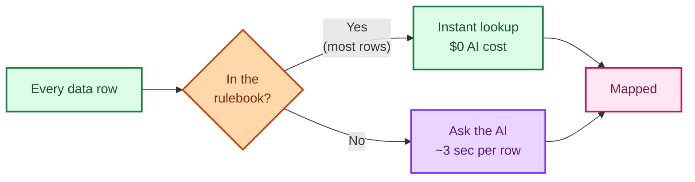

# T12 Mapping — Architecture Diagram

End-to-end component flow from raw T12 Excel file to final mapped output, ready for analyst review.

## Component flow

```mermaid
flowchart TD
    Input[/"Raw T12 Excel File<br/><b>.xlsx from vendor</b>"/]

    Parser["<b>Parsing Module</b><br/>Reads Excel structure<br/>Extracts every cell, row, sheet"]

    JSON1[("Structured JSON<br/>Initial representation")]

    Detection["<b>Detection Module</b><br/>Identifies blocks<br/>Tags each row:<br/>header / subtotal / data<br/>revenue / expense / capex"]

    JSON2[("Annotated JSON<br/>Rows with type + flags<br/>(is_total_revenue,<br/>is_total_expense, is_noi)")]

    subgraph NOIBlock["NOI Verification Module"]
        direction TB
        Extract["Extract Actual NOI<br/>Reads vendor's reported<br/>NOI directly from the file"]
        Calculate["Calculate NOI<br/>Sums revenue rows<br/>minus expense rows"]
        Compare{"Compare<br/>Vendor NOI<br/>vs<br/>Calculated NOI"}
        Extract --> Compare
        Calculate --> Compare
    end

    JSON2 --> NOIBlock

    Decision{"Match?<br/>(pass/fail)<br/>Does the analyst<br/>want changes?"}

    Recompute["Apply Corrections<br/>Re-classify subtotal rows<br/>+ recompute NOI"]

    AutoMap["<b>Auto-Mapping</b><br/>Rulebook lookup<br/>Every known description →<br/>canonical category"]

    Unmapped{"Any rows<br/>unmapped?"}

    AIMap["<b>AI Mapping</b><br/>OpenAI fallback<br/>Suggests category +<br/>confidence + reasoning<br/>(only for unknown rows)"]

    Result[/"Final Mapped Output<br/>Shown to Analyst<br/><b>Spreadsheet-style review table</b>"/]

    Input --> Parser
    Parser --> JSON1
    JSON1 --> Detection
    Detection --> JSON2
    NOIBlock --> Decision
    Decision -- "No changes<br/>(NOI passes)" --> AutoMap
    Decision -- "Analyst picks<br/>different row" --> Recompute
    Recompute --> NOIBlock
    AutoMap --> Unmapped
    Unmapped -- "No" --> Result
    Unmapped -- "Yes" --> AIMap
    AIMap --> Result

    classDef inputClass fill:#dbeafe,stroke:#1e40af,stroke-width:2px,color:#1e3a8a
    classDef processClass fill:#dcfce7,stroke:#15803d,stroke-width:2px,color:#14532d
    classDef storageClass fill:#fef3c7,stroke:#a16207,stroke-width:2px,color:#713f12
    classDef decisionClass fill:#fed7aa,stroke:#c2410c,stroke-width:2px,color:#7c2d12
    classDef aiClass fill:#e9d5ff,stroke:#7c3aed,stroke-width:2px,color:#581c87
    classDef noiClass fill:#cffafe,stroke:#0e7490,stroke-width:2px,color:#164e63
    classDef resultClass fill:#fce7f3,stroke:#be185d,stroke-width:3px,color:#831843

    class Input inputClass
    class Parser,Detection,Recompute,AutoMap processClass
    class JSON1,JSON2 storageClass
    class Decision,Unmapped decisionClass
    class AIMap aiClass
    class Extract,Calculate,Compare noiClass
    class Result resultClass

    style NOIBlock fill:#ecfeff,stroke:#0e7490,stroke-width:2px,color:#164e63
```

---

## Components at a glance

| # | Component | Purpose |
|---|---|---|
| 1 | **Raw T12 Excel File** | Vendor-supplied `.xlsx` with last 12 months of income/expense data |
| 2 | **Parsing Module** | Opens the Excel file, reads every cell, sheet, and row into memory |
| 3 | **Structured JSON** | Internal data format the rest of the system works on (no more Excel after this) |
| 4 | **Detection Module** | Identifies the structure: which rows are headers, subtotals, data rows; which side of the income statement each row belongs to (revenue / expense / capex); flags the key subtotal rows |
| 5 | **Annotated JSON** | Same rows, now with classification tags attached |
| 6 | **NOI Verification Module** | Two parallel calculations + comparison — the system's automatic quality check |
| 6a | • Extract Actual NOI | Reads the vendor's reported NOI directly from the file |
| 6b | • Calculate NOI | Independently computes NOI from the row data (revenue − expense) |
| 6c | • Compare | Confirms the vendor's math matches the row math |
| 7 | **Decision point** | If NOI mismatches or the analyst spots a wrong subtotal selection, they pick the correct row and the flow loops back. Otherwise it proceeds to mapping. |
| 8 | **Auto-Mapping** | Looks up every data row in the firm's rulebook (the system's memory of past mappings). Known descriptions get assigned a canonical category instantly. |
| 9 | **AI Mapping** | Only for rows the rulebook hasn't seen before. OpenAI proposes a category from the firm's canonical list with a confidence score. |
| 10 | **Final Mapped Output** | Every row presented to the analyst in a review table — editable, with overrides preserved separately so the original recommendation is never lost |

---

## Why two mapping layers

- **Rulebook layer** — current rulebook has **1,894 known descriptions** across 37 canonical categories. Lookups are instant and free.
- **AI fallback** — runs only when the rulebook can't decide. Returns a structured suggestion (category + confidence + reasoning) so the analyst can quickly judge whether to accept or override.

The rulebook grows every time the firm reviews more files, so the share of rows needing AI fallback drops over time.

---

## Legend

| Color | Component type |
|---|---|
| 🟦 Blue | Input — vendor's raw file |
| 🟩 Green | Processing modules — parsing, detection, mapping |
| 🟨 Yellow | Storage — intermediate JSON representations |
| 🟧 Orange | Decision points — branches in the flow |
| 🟪 Purple | AI / external services — OpenAI fallback |
| 🟫 Cyan | NOI Verification subcomponents |
| 🟥 Pink | Final output — what the analyst sees |

---

*For an in-depth walkthrough of the analyst's user journey and a non-diagram-heavy narrative, see [`WORKFLOW_OVERVIEW.md`](./WORKFLOW_OVERVIEW.md).*
*For engineering reference (file paths, function names, JSON contracts), see [`WORKFLOW.md`](./WORKFLOW.md).*
