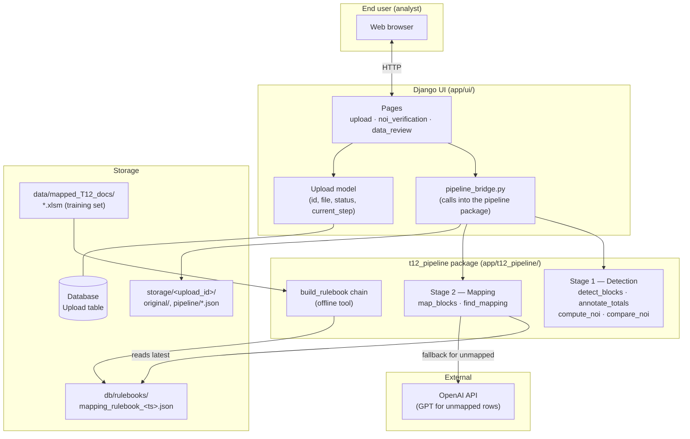
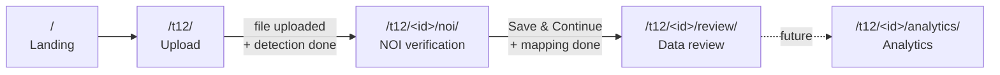
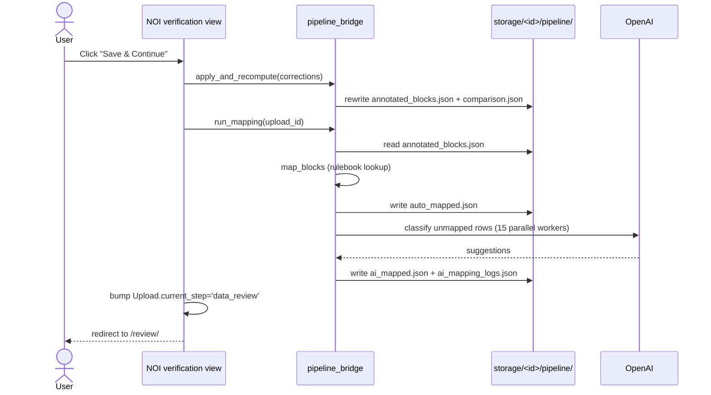
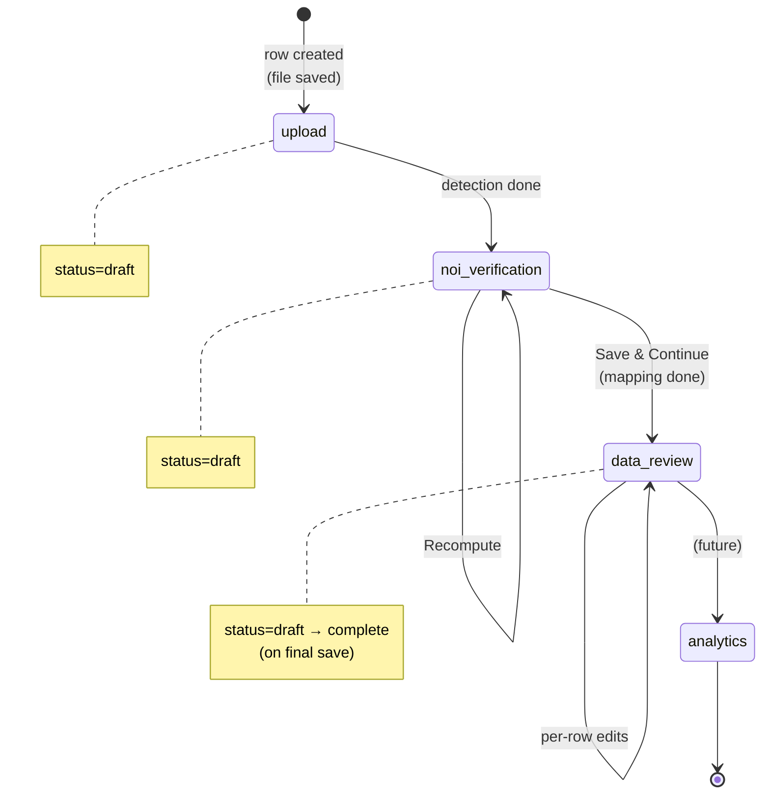
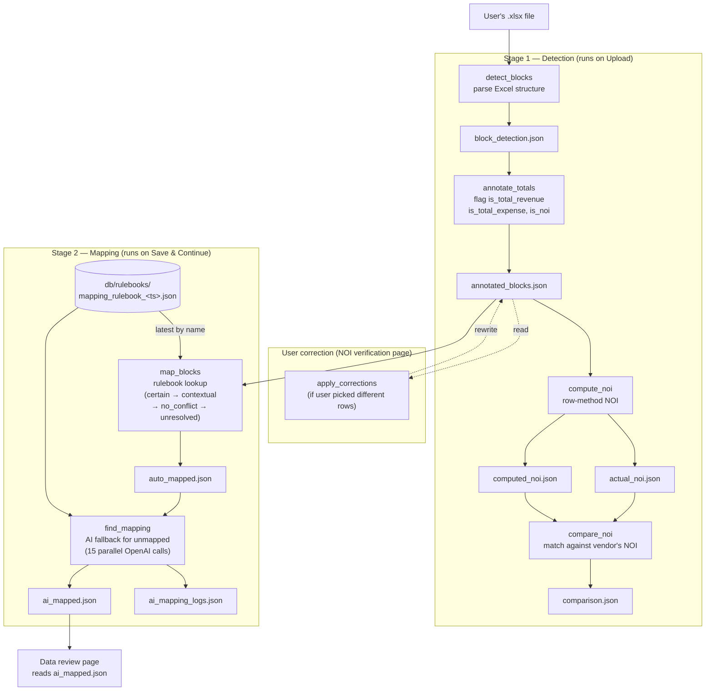
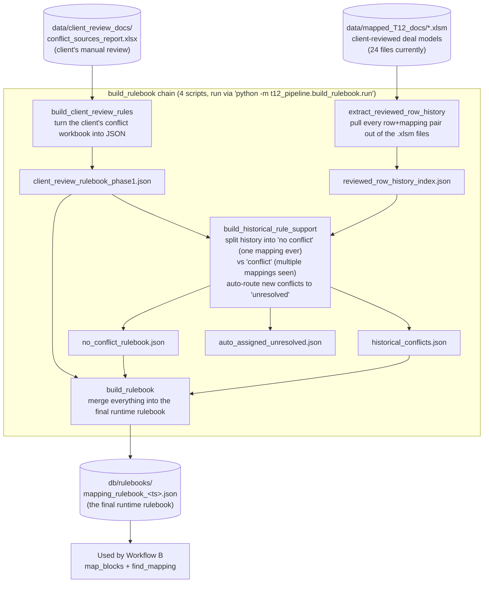
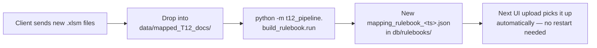

# T12 Mapping — System Workflow

This document covers the full workflow for the T12 mapping system: what users see in the UI, what runs internally for each upload, and how the rulebook (the system's "memory" of past decisions) gets built.

The doc is layered — read top to bottom for a complete overview, or jump to the section you need:

1. [What the system does](#1-what-the-system-does) — plain English overview
2. [System architecture](#2-system-architecture) — how the pieces fit together
3. [User journey](#3-user-journey-ui-workflow) — step-by-step from the user's perspective
4. [Per-T12 pipeline](#4-per-t12-pipeline-workflow-b) — what runs internally for each upload
5. [Rulebook build](#5-rulebook-build-workflow-a) — the occasional offline training process
6. [File artifacts reference](#6-file-artifacts-reference) — every JSON file the system writes

---

## 1. What the system does

When an analyst gets a Trailing-Twelve-Month (T12) Excel file from a vendor (a property's income statement for the last 12 months), they need to map every line item to Oakdale's canonical chart of accounts so the data can be analyzed consistently across deals.

Doing this by hand for hundreds of line items per file is slow and inconsistent. This system automates it:

- The analyst uploads the raw Excel file in a web UI.
- The system detects the file's structure (which rows are revenue, expense, subtotals, headers), verifies the vendor's reported NOI matches the row math, and maps every line item to a canonical category using a **rulebook** of past human decisions, with an AI fallback for line items it hasn't seen before.
- The analyst reviews the mappings in a table, fixes anything the system got wrong, and proceeds to analytics.

There are **two distinct workflows** in this system:

| Workflow | When it runs | Who triggers it |
|---|---|---|
| **A — Rulebook build** | Occasionally, when new reviewed files arrive from the client | Engineer (CLI) |
| **B — Per-T12 processing** | Every time someone uploads a T12 file | Analyst (in UI) |

Workflow A produces the **rulebook**; Workflow B consumes it. They share no live state — they only meet at the rulebook file on disk.

---

## 2. System architecture



**Key boundaries:**

- The **UI** never imports pipeline logic directly. Everything goes through `pipeline_bridge.py`, which takes an `upload_id` and uses the storage abstraction (`shared/storage.py`). This means the UI doesn't care whether files live on local disk or S3.
- The **pipeline** package has no Django dependency. It can be run as a CLI (`python -m t12_pipeline.pipeline.run_pipeline ...`) or imported by the UI.
- The **rulebook** is the only shared state between Workflow A and Workflow B. Workflow A writes it, Workflow B reads it.

---

## 3. User journey (UI workflow)

What an analyst does when they have a new T12 to process. Four pages, four file handoffs.



Each page's job:

| Page | URL | What the user does | What the system does | Time |
|---|---|---|---|---|
| **Landing** | `/` | Pick a tool (T12 Mapping) | Static workflow selector | — |
| **Upload** | `/t12/` | Choose `.xlsx` file, set property name, click "Parse File" | Creates `Upload` row, saves file, **runs Stage 1 (detection)** synchronously, redirects | ~5 s |
| **NOI verification** | `/t12/<id>/noi/` | Confirm which rows are Total Revenue / Total Expense / NOI. Click "Recompute" to test corrections, "Save & Continue" when satisfied. | Reads JSONs, optionally applies user corrections, **runs Stage 2 (mapping)** on Save, redirects | Recompute < 1 s; Mapping 30–180 s |
| **Data review** | `/t12/<id>/review/` | Eyeball every row's mapped category, override anything wrong via dropdown, toggle flip-sign on rows where the vendor used the wrong sign | Patches `ai_mapped.json` per row edit | Per-row save < 1 s |
| **Analytics** (future) | `/t12/<id>/analytics/` | Charts and summary numbers | TBD | — |

### What "Save & Continue" actually does on the NOI page



This is the slowest user-visible step. The user sees a "Mapping in progress…" spinner for 30–180 seconds while the AI fallback runs. There's no progress bar — the request is synchronous.

### Upload lifecycle state machine

Each `Upload` row's `current_step` field walks through these states as the user progresses:



The `status` field is independent and currently only goes `draft` → `complete` when the analyst finishes. A future cleanup job will delete drafts older than N days.

---

## 4. Per-T12 pipeline (Workflow B)

What happens internally between "user clicks Parse File" and "user sees mapped categories." Two stages, six substeps, eight output JSONs per upload.



### Stage 1 — Detection (runs synchronously on upload, ~5 s)

| Substep | Reads | Writes | What it does |
|---|---|---|---|
| `detect_blocks` | raw `.xlsx` | `block_detection.json` | Format-aware parser. Detects which format the vendor uses (`code_in_a_desc_in_b` / `embedded_code_in_a` / `no_code`), classifies every row as `data` / `subtotal` / `header` / `empty`, assigns `statement_side` (revenue / expense / capex) via a two-flag state machine. |
| `annotate_totals` | `block_detection.json` | `annotated_blocks.json` | Stamps `is_total_revenue`, `is_total_expense`, `is_noi` booleans on the right subtotal rows. Uses keyword lists and dedup logic. |
| `compute_noi` | `annotated_blocks.json` | `actual_noi.json`, `computed_noi.json` | Two views of NOI: the vendor's reported NOI (read from the `is_noi` row) vs the row-method NOI (sum of revenue rows − sum of expense rows, capex skipped). |
| `compare_noi` | `actual_noi.json`, `computed_noi.json` | `comparison.json` | Compares the two NOIs and per-month values. Decides pass/fail based on a `STRICT` flag (exact match) or tolerance ($1 / 1 %). |

After Stage 1, the user sees the NOI verification page with all three subtotal rows pre-detected and a pass/fail badge.

### User correction loop (on NOI page)

If the system detected the wrong row as Total Revenue (or Total Expense, or NOI), the user picks the right one from a dropdown and clicks "Recompute". This calls `corrections.apply_corrections()` which:

1. Clears the old flag(s)
2. Sets the new flag on the user-chosen row
3. **Re-walks `statement_side`** across all rows (the state machine flips at the new revenue/NOI rows)
4. Re-runs `compute_noi` + `compare_noi`
5. **Overwrites** `annotated_blocks.json` and `comparison.json` so refresh shows the latest state

### Stage 2 — Mapping (runs synchronously on Save & Continue, 30–180 s)

| Substep | Reads | Writes | What it does |
|---|---|---|---|
| `map_blocks` | `annotated_blocks.json`, **latest rulebook** | `auto_mapped.json` | For every data row, looks up its description in the rulebook in this order: `certain` → `contextual` → `no_conflict` → `unresolved`. If found, sets `mapping`. If not, marks `not_found=true`. |
| `find_mapping` | `auto_mapped.json`, rulebook | `ai_mapped.json`, `ai_mapping_logs.json` | For every `not_found` row, sends the description + section context to OpenAI with the canonical category list. Sets `ai_suggested_mapping`, `ai_confidence`, `ai_reasoning`. Runs 15 concurrent requests. Logs every prompt/response for audit. |

After Stage 2, the user lands on the data review page. Every data row has an "effective mapping" computed as:

```
final_mapping  ??  mapping  ??  ai_suggested_mapping  ??  None
```

When the user changes the dropdown for a row, the system writes `final_mapping` (preserving `mapping` and `ai_suggested_mapping` underneath, so clearing the override restores the original).

### Rulebook pickup logic

Both the UI bridge and the CLI manifest runner pick the rulebook the same way:

```python
sorted(DB_RULEBOOKS_DIR.glob("mapping_rulebook_*.json"))[-1]
```

Filenames are `mapping_rulebook_YYYY_MM_DD_HHMM.json`, so lexicographic sort = chronological sort. No env var, no config — drop a newer file in `db/rulebooks/` and the next upload uses it.

---

## 5. Rulebook build (Workflow A)

Triggered manually when new reviewed `.xlsm` files arrive from the client. The rulebook is the system's "memory" of every mapping decision the client has confirmed. Each row description gets routed into one of four buckets.



### The four buckets in the runtime rulebook

| Bucket | Meaning | Runtime behavior |
|---|---|---|
| `certain` | Client said "this description always maps to X" | Direct lookup → map_blocks assigns the category |
| `contextual` | Client said "this description maps differently based on context (e.g. which section it appears in)" | Context-aware lookup → map_blocks checks `section_path` |
| `no_conflict` | Description appears across .xlsm files with only one mapping ever (no human decision needed) | Direct lookup |
| `unresolved` | Client said "I can't decide" OR description wasn't in the client review workbook yet (**auto-routed**) | Lookup misses → row gets sent to AI fallback (`find_mapping`) with the historical candidates as hints |

### Auto-routing for unreviewed conflicts

When new `.xlsm` training files introduce conflict descriptions the client hasn't yet seen, they used to fail the build. They now get auto-routed to `unresolved` with a stub `client_review_entry` flagged `auto_assigned=True`, and a list of them is written to `output_docs/<ts>/build_rulebook/historical_rule_support/auto_assigned_unresolved.json`.

The list goes to the client; they categorize the entries properly in `conflict_sources_report.xlsx`; on the next rebuild those entries move out of the auto-routed list and into their proper bucket.

### When to rebuild



The rulebook is currently ~700 KB (1894 descriptions across all four buckets). Builds in ~30 s.

---

## 6. File artifacts reference

Every JSON file the system writes, what's in it, and which stage owns it.

### Per-upload artifacts (in `storage/<upload_id>/pipeline/`)

| File | Written by | Read by | Contents |
|---|---|---|---|
| `block_detection.json` | Stage 1a — `detect_blocks` | Stage 1b | Rows with `row`, `type`, `description`, `section_context`, `section_path`, `values`, `statement_side` |
| `annotated_blocks.json` | Stage 1b — `annotate_totals`; rewritten by `corrections` | Stages 1c, 2a; NOI page | All Stage 1a fields + `is_total_revenue`, `is_total_expense`, `is_noi` booleans |
| `actual_noi.json` | Stage 1c — `extract_actual_noi` | Stage 1d; data review page | Vendor's reported NOI: row reference + monthly values |
| `computed_noi.json` | Stage 1c — `compute_noi` | Stage 1d | Row-method NOI: revenue/expense/NOI per month, subtotal anchors |
| `comparison.json` | Stage 1d — `compare_noi`; rewritten on Recompute | NOI page | `overall_pass`, `totals.{revenue, expense, noi}.{actual, computed, diff, match}`, `months[]` (same shape per-month), `tolerance_used` |
| `auto_mapped.json` | Stage 2a — `map_blocks` | Stage 2b | All annotated fields + `mapping`, `not_found`, `mapping_source` |
| `ai_mapped.json` | Stage 2b — `find_mapping`; patched per row in data review | Data review page | Stage 2a fields + `ai_suggested_mapping`, `ai_confidence`, `ai_reasoning`, `final_mapping` (user override), `flip_sign` |
| `ai_mapping_logs.json` | Stage 2b — `find_mapping` | (audit only) | Per-row prompt / response / latency from OpenAI |

### Rulebook artifacts (in `db/rulebooks/` and `output_docs/`)

| File | Where | Written by | Purpose |
|---|---|---|---|
| `mapping_rulebook_<ts>.json` | `db/rulebooks/` (committed to git) | `build_rulebook.py` | The active runtime rulebook. Pipeline picks the newest by filename. |
| `client_review_rulebook_phase1.json` | `output_docs/<ts>/build_rulebook/client_review_rules/` | `build_client_review_rules.py` | Intermediate: the client's conflict review workbook as JSON |
| `reviewed_row_history_index.json` | `output_docs/<ts>/build_rulebook/reviewed_row_history/` | `extract_reviewed_row_history.py` | Intermediate: every row mapping ever seen across .xlsm files |
| `no_conflict_rulebook.json` | `output_docs/<ts>/build_rulebook/historical_rule_support/` | `build_historical_rule_support.py` | Intermediate: descriptions with only one mapping ever |
| `historical_conflicts.json` | same | same | Intermediate: descriptions with multiple mappings (need a bucket) |
| `auto_assigned_unresolved.json` | same | same | List of conflicts auto-routed to `unresolved` because the client hasn't reviewed them yet — **send this to the client** |

### Database (`Upload` model)

| Field | Type | Notes |
|---|---|---|
| `id` | UUID (PK) | Generated client-side; embedded in every URL |
| `file` | FileField | Original .xlsx, stored under `<id>/original/<filename>` |
| `file_name` | char(255) | The user's original filename |
| `property_name` | char(255) | User-entered or auto-filled from filename |
| `status` | `draft` / `complete` | Lifecycle; future cleanup deletes old drafts |
| `current_step` | `upload` / `noi_verification` / `data_review` / `analytics` | Where the user got to last |
| `created_at` / `updated_at` | timestamp | Standard |
| `user` | FK to auth.User (nullable) | Multi-user filtering when auth is added |

---

## Updating this document

If you change a workflow:

- New page in the UI? Update §3 (user journey table + state machine).
- New pipeline substep? Update §4 (stage table) and §6 (artifacts table).
- New build_rulebook script? Update §5 (chain diagram) and §6 (rulebook artifacts table).
- New external service? Update §2 (architecture diagram).

The Mermaid diagrams render natively in GitHub, VS Code preview, and most modern Markdown renderers. To export a diagram as an image, paste it into [mermaid.live](https://mermaid.live).
