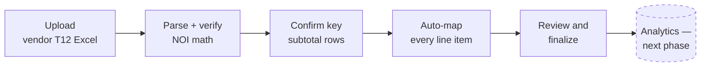
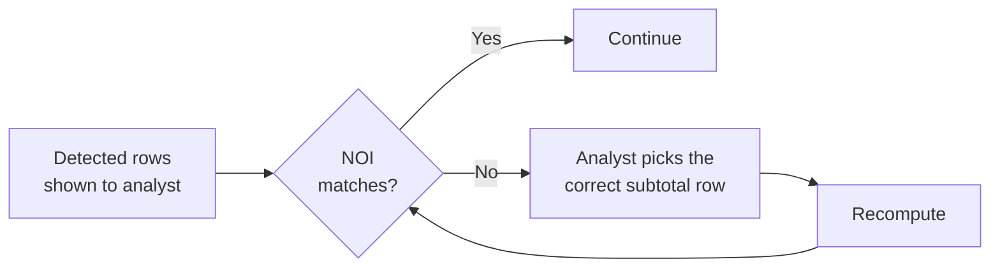
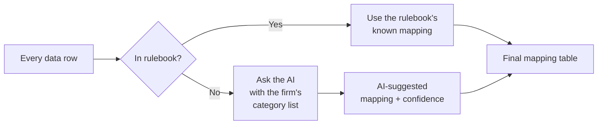
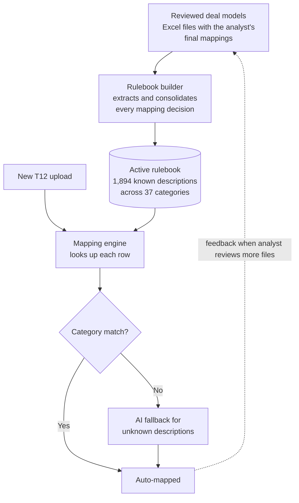

# T12 Mapping System — Workflow Overview

## What the system does

When an analyst receives a vendor's Trailing-Twelve-Month (T12) income statement, every line item — hundreds of them per file, with vendor-specific naming — has to be mapped to the firm's canonical chart of accounts so the data can be compared across deals.

Doing this by hand is slow, inconsistent, and easy to get wrong. This system automates it end-to-end:

- The analyst uploads the vendor's Excel file in a web UI.
- The system parses the file, **verifies the math** against the vendor's reported NOI, and maps every line item to a canonical category using a **rulebook** that records every mapping decision the firm has previously approved.
- For categories the rulebook hasn't seen before, an AI fallback proposes a mapping with a confidence score.
- The analyst reviews the results, overrides anything that needs correcting, and moves on to analytics.

**Why it matters:** every analyst review feeds back into the rulebook, so the system gets faster and more accurate over time. After 24 reviewed files the rulebook already covers 1,894 distinct line-item descriptions — most new uploads now map automatically with little or no analyst correction needed.

---

## Workflow at a glance

Each step is described below.

---

## How an analyst uses the system

### Step 1 — Upload

The analyst picks a vendor `.xlsx` T12 file, types a property name (auto-filled from the filename), and clicks **Parse File**.

The system parses the file's structure — every row is classified as a header, subtotal, data row, revenue, expense, or capital expenditure — and computes NOI two independent ways:

- The vendor's reported NOI (read directly from the NOI row in the file)
- The system's computed NOI (sum of revenue rows minus sum of expense rows)

Parsing takes about 5 seconds.

### Step 2 — NOI verification

The analyst sees three pre-detected subtotal rows — Total Revenue, Total Expense, NOI — with a **NOI PASS / NOI FAIL** badge and the per-month math. If the system picked the wrong row, the analyst picks the right one from a dropdown and clicks **Recompute**. Pass means the vendor's math agrees with ours; fail means there's a discrepancy to investigate before moving on.

This is a **quality gate**: nothing proceeds to mapping until the analyst confirms NOI is correct.

### Step 3 — Mapping (automatic)

When the analyst clicks **Save & Continue**, the system maps every data row to a category from the firm's chart of accounts. It happens in two layers:

- **Rulebook layer** — rows the firm has classified before are mapped instantly with no AI cost.
- **AI fallback** — only rows the rulebook hasn't seen go to the AI, which returns a category from the canonical list plus a confidence score and reasoning.

This step typically takes 30–90 seconds for a full T12, depending on how many rows fall through to the AI.

### Step 4 — Review and override

The analyst sees every row in a spreadsheet-style table with:

- The original description from the vendor
- The mapped category (rulebook hit or AI suggestion)
- A dropdown to override the category if needed
- A flip-sign toggle for rows the vendor entered with the wrong sign (e.g. a vacancy recorded as a positive number under revenue)
- The monthly values
- A live-updating **Calculated NOI vs Original NOI** comparison at the bottom

Rows are colour-coded so attention-needing items pop:

- **AI-suggested rows** (yellow) — the AI's best guess, worth a glance
- **Unmapped rows** (red) — neither rulebook nor AI was confident, needs analyst decision
- **Subtotals and headers** — shown in context but not editable

Analyst overrides are saved per row (no "Save All" button needed). The system preserves the original recommendation, so clearing an override restores it — no data loss.

---

## How the system learns: the rulebook

The rulebook is the system's memory of every mapping the firm has approved. It's the reason the system gets smarter over time.

The rulebook has four kinds of entries:

| Bucket | What it means |
|---|---|
| **Certain** | The firm decided this description always maps to the same category, no exceptions. |
| **Contextual** | The same description maps differently depending on which section of the T12 it appears in. |
| **No-conflict history** | The description has only ever been mapped one way across all training files. |
| **Unresolved** | The firm hasn't decided yet — AI fallback handles these at runtime with the candidate mappings as hints. |

**The growth loop:** each new reviewed file added to training adds new "certain" / "no-conflict" entries → the next upload has fewer rows falling to the AI → faster processing, lower AI cost, more consistency.

After 24 reviewed files we're at 1,894 known descriptions. Most new T12s from familiar vendors now map automatically with little AI involvement.

---

## Quality checks built in

The system has multiple checkpoints so errors don't quietly slip through:

| Check | When | What it catches |
|---|---|---|
| **NOI verification** | After parsing | Wrong row picked as Total Revenue / Expense / NOI; arithmetic mismatch between row math and vendor's reported NOI |
| **Rulebook lookup** | During mapping | Inconsistent categorization across files (rulebook locks in the firm's previous decision) |
| **AI confidence score** | During mapping | Low-confidence AI suggestions get flagged (yellow) so the analyst eyeballs them |
| **Per-row review UI** | After mapping | Analyst can override anything; original recommendation is preserved underneath in case of mistakes |
| **Audit trail** | Throughout | Every AI prompt, response, and analyst override is logged for traceability |

---

## Two parts of the system

The system has two pieces that interact through the rulebook file:

| Piece | When it runs | Who triggers it |
|---|---|---|
| **Per-T12 processing** | Every time a T12 is uploaded | Analyst (in the web UI) |
| **Rulebook builder** | When new reviewed files arrive from the firm | Engineer (offline, periodic) |

The rulebook builder is the **slow, occasional** process — it consolidates the firm's reviewed files into the active rulebook. The per-T12 processing is the **fast, frequent** path that uses the rulebook to process new uploads. They share no live state — the rulebook file on disk is the only handoff.

When new reviewed files arrive:

1. Engineer drops the new `.xlsm` files into the training folder.
2. Engineer runs the rulebook builder (~30 seconds).
3. The next analyst upload automatically uses the updated rulebook — no restart, no UI change.
